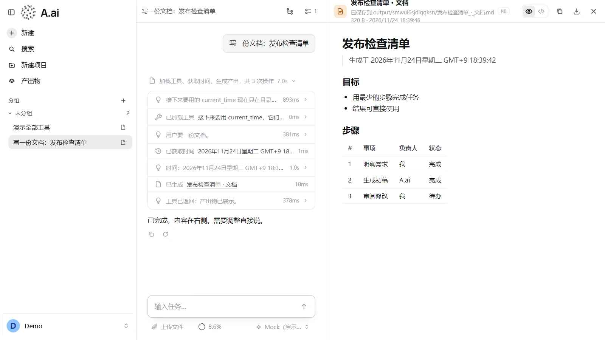
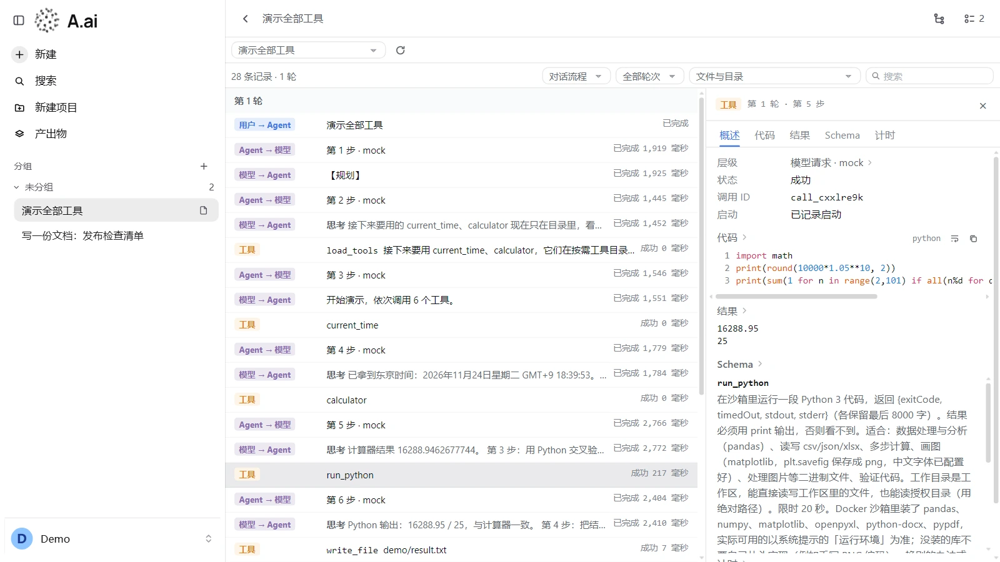

<p align="center"></p>
<h1 align="center">A.ai</h1>
<p align="center"><strong>可查看执行过程、可交付文件的 AI Agent 工作台</strong></p>
<p align="center">
  <a href="#快速开始">快速开始</a> ·
  <a href="#接入模型">接入模型</a> ·
  <a href="#构建与部署">构建与部署</a> ·
  <a href="#项目结构">项目结构</a>
</p>

A.ai 把对话、工具调用和产出放在同一个工作区。你可以让 Agent 读取资料、运行脚本、整理结果，并在右侧预览生成的报告、网页或文件。需要核对结果时，可以回到对应轮次，查看已记录的模型请求、工具参数、返回结果和耗时。



*本地 Mock 演示。对话中可以展开工具执行步骤，右侧可预览或下载生成的文档。*

## 能做什么

- **在对话中完成工作。** Agent 可以读写工作区文件、运行 Python 和终端命令、搜索网页。需要确认的操作会在对话内请求审批。
- **预览和继续处理产出。** 在右侧打开报告、网页和代码，查看文件改动或下载结果。保存为工作区应用的网页可以从「产出物」再次打开。
- **把任务拆给子 Agent。** 在多 Agent 模式下，主 Agent 可以分派子任务并汇总结果。线程面板可以打开分支对话、补充要求，以及恢复已结束的任务。
- **回查一次任务是怎么完成的。** 从会话菜单进入「轨迹」或「统计」，按轮次检查模型往来和工具调用，查看 token 用量与耗时。



## 快速开始

准备 Git、Node.js 和项目锁定的 pnpm 版本。推荐使用 Node.js 24，项目声明的最低版本为 22.13，`package.json` 指定 pnpm 11.10.0。已安装 Corepack 时，可以用 `corepack enable` 启用项目指定的 pnpm。

```bash
git clone https://github.com/cxwhhh/a-ai.git
cd a-ai
pnpm install --frozen-lockfile
pnpm dev
```

1. 打开 [127.0.0.1:3000](http://127.0.0.1:3000)，注册并登录本地账号。
2. 保持默认的 **Mock** 模型，输入 `写一份文档：发布检查清单` 并按 Enter。通过右上角「任务与文件」打开生成的文档。这个演示无需模型 API Key 或 Python。
3. 想体验获取时间、计算、运行 Python、写文件、列目录和生成报告，发送 `演示全部工具`。这个演示需要 Python 3。默认调用 `python3`，Windows 上可以在 `.env.local` 中将 `A_PYTHON` 设为 `python` 或 Python 的完整路径，设置后重启服务。

## 接入模型

从左下角账号菜单打开「设置 → 模型 → 添加模型服务」，选择服务商，填写接口地址和 API Key，测试连接后添加要使用的模型。回到对话，在输入框下方切换模型。

| 连接方式 | 可接入的服务 |
| --- | --- |
| Anthropic 接口 | Claude |
| OpenAI 兼容接口 | DeepSeek、OpenAI、通义千问，以及通过「其他」添加的兼容端点 |
| 本地模型 | 可连接提供 OpenAI 兼容接口的 Ollama 等本地服务。接口地址须能从 A.ai 服务端访问。 |

## 构建与部署

### Web 和 CLI

```bash
pnpm build
pnpm start
```

服务默认监听 `127.0.0.1:3000`。可参考 [环境变量示例](./.env.example) 创建 `.env.local`。会话和设置默认保存在仓库的 `.data` 目录。

构建后执行 `pnpm cli help` 可查看发送消息、列出会话、跟踪和停止运行的命令。CLI 连接同一个 HTTP 服务，使用 `A_AI_USERNAME` 和 `A_AI_PASSWORD` 登录，或通过 `A_AI_SESSION` 使用已有会话。

### Docker Compose

在 Linux 上，将宿主机 Docker 组的 GID 写入仓库根目录的 `.env`，例如 `DOCKER_GID=999`。可用 `getent group docker | cut -d: -f3` 查询实际值。

```bash
docker compose build sandbox-image
docker compose up -d --build a-ai
docker compose ps a-ai
```

用浏览器打开服务的 `/login` 检查页面，可用 `docker compose logs -f a-ai` 查看日志。升级前备份 `a-ai-data` 卷，更新代码后重新执行上述构建和启动命令。该卷存放 SQLite 数据和工作区，保留卷即可跨容器重建使用原有数据。

默认 Compose 配置将 3000 端口映射到宿主机，并挂载 Docker socket 以启动工具沙箱。用于服务器部署时，建议将端口绑定至 `127.0.0.1` 并通过 HTTPS 反向代理访问。创建账号后可在 Compose 中将 `A_ALLOW_SIGNUP` 设为 `0`，再执行 `docker compose up -d a-ai` 生效。

### 桌面端

在 Windows 或 macOS 上，使用 `pnpm electron:dev` 启动 Electron 开发版。Windows 安装包用 `pnpm dist:win` 构建，macOS 安装包用 `pnpm dist:mac` 构建，产物写入 `release/`。

## 项目结构

| 目录 | 职责 |
| --- | --- |
| `apps/web`、`apps/server` | Vite 前端入口和 Node.js HTTP / SSE 服务 |
| `apps/desktop`、`apps/cli` | Electron 客户端和命令行入口 |
| `packages/ui`、`packages/protocol` | 对话工作区组件及共享协议 |
| `packages/agent-loop`、`packages/subagent`、`packages/context-engine` | Agent 执行循环、任务分派和上下文管理 |
| `packages/tool-runtime`、`packages/tools`、`packages/sandbox` | 工具调用、内置工具和脚本执行环境 |
| `packages/storage`、`packages/conversation-trace` | SQLite 存储、对话轨迹与调用统计 |
| `packages/runtime`、`vendor/cordis` | 运行时服务装配和 Cordis 插件核心 |

开发检查使用 `pnpm typecheck` 和 `pnpm test`。其中 `pnpm test` 会先构建，再运行行为测试。

[学习笔记](./docs/学习笔记.md) · [Agent 评测方法与综合测试用例](./docs/Agent评测方法与综合测试用例.md) · [第三方组件说明](./THIRD_PARTY_NOTICES.md)
