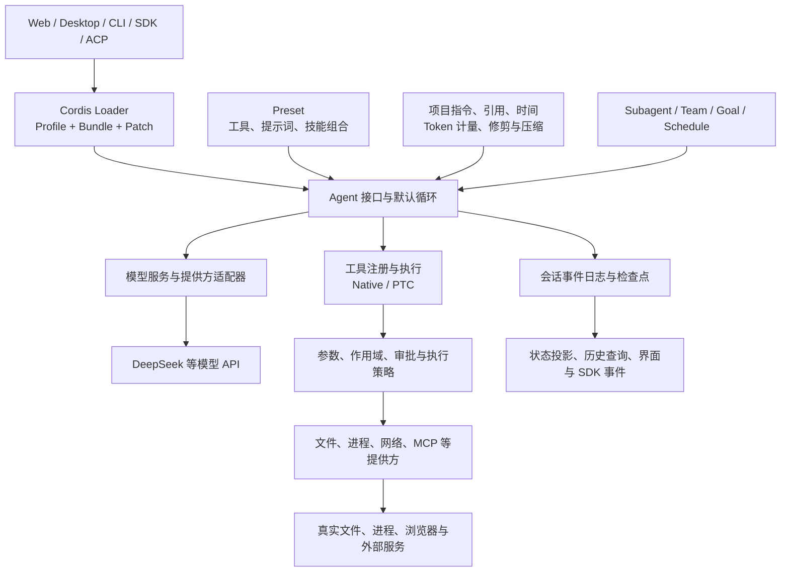
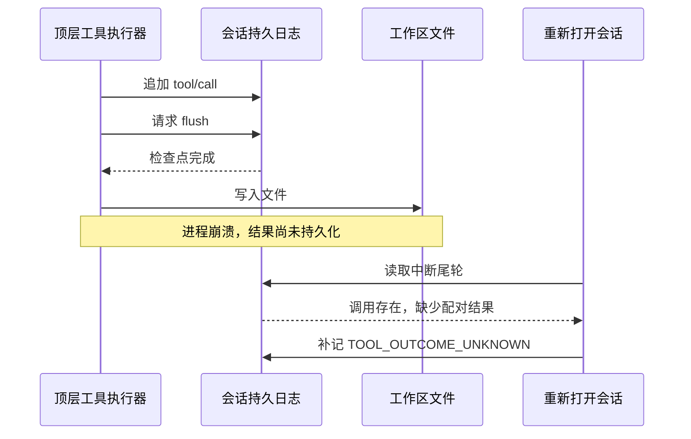
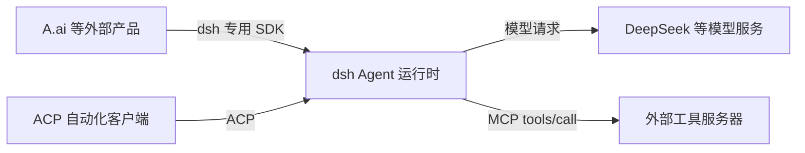
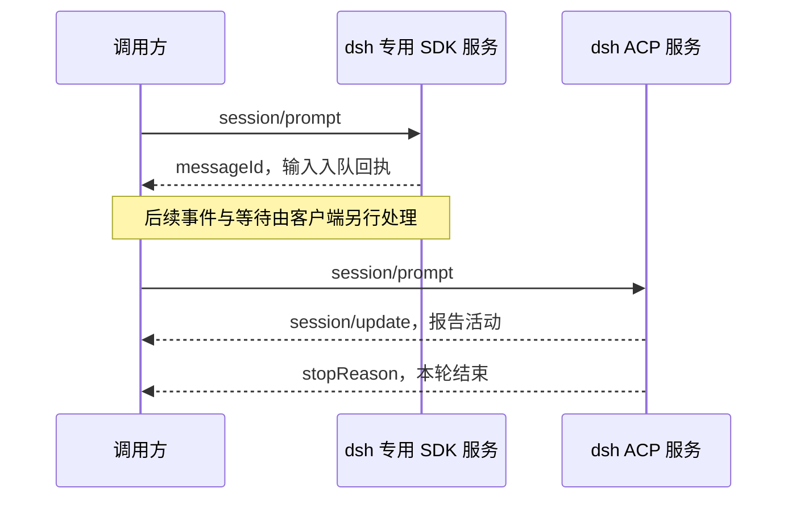
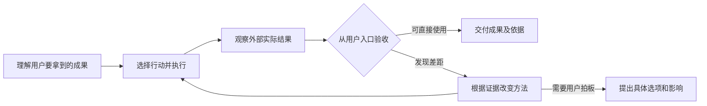
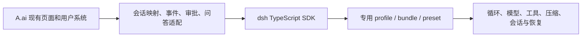

# DSH 项目全景分析与 Agent 能力研究

整理日期：2026-11-06。

本文汇总本次对话从最初熟悉 DeepSeek Harness，到目录分析、系统架构、故障恢复、联网资料核对，以及 Claude 桌面端体验与 Agent 能力评价的全部实质讨论。采用按主题整编的方式合并重复内容，在末尾保留对话推进索引。对于后续源码阅读纠正的早期判断，正文采用修正后的结论，并单列修正记录。

研究对象的本地根目录为 `E:\cxw\projects\deepseek-harness-master\deepseek-harness-master`，读取到的根版本为 `0.2.2-rc.1`。A.ai 根目录为 `E:\cxw\projects\A\a-ai`。文中源码路径均使用绝对路径。

本地材料来自这份源码副本。联网材料来自上游 GitHub、DeepSeek 官网、协议官方文档与 Anthropic 官方资料。本地目录没有可供本次核对的 Git 提交身份，在线 master 文档也会继续变化，因此下面的结论具有对应源码和文档的版本边界。

## 阅读导航

1. [用户真正关心的问题与研究目标](#1-用户真正关心的问题与研究目标)
2. [项目定位、技术基础与整体架构](#2-项目定位技术基础与整体架构)
3. [顶层目录与开发交付体系](#3-顶层目录与开发交付体系)
4. [应用入口与 Python 接入](#4-应用入口与-python-接入)
5. [全部能力分组详解](#5-全部能力分组详解)
6. [一次任务的完整运行过程](#6-一次任务的完整运行过程)
7. [原生系统组件、沙箱与文件锁](#7-原生系统组件沙箱与文件锁)
8. [会话恢复、检查点与结果未知](#8-会话恢复检查点与结果未知)
9. [SDK、ACP、MCP 与模型 API](#9-sdkacpmcp-与模型-api)
10. [设计思路、特别之处与代价](#10-设计思路特别之处与代价)
11. [什么样的 Agent 才算智能、能干活、好用](#11-什么样的-agent-才算智能能干活好用)
12. [Claude 桌面端与 dsh 的体验比较](#12-claude-桌面端与-dsh-的体验比较)
13. [如何进行真实任务对照](#13-如何进行真实任务对照)
14. [A.ai 的复用方向与现有能力](#14-aai-的复用方向与现有能力)
15. [早期结论修正表](#15-早期结论修正表)
16. [图件、来源、验证与对话索引](#16-图件来源验证与对话索引)

## 1. 用户真正关心的问题与研究目标

最初的需求是“以后很多东西直接用 DeepSeek 上面的东西”，并指定 dsh 本地源码供研究。这意味着后续选型应优先核对 dsh 已有能力，减少重复实现，但具体接入仍需要比较当前实现和产品需求。

对话随后从“文件夹分别做什么”推进到“它怎样协作、为什么这样设计”。最后用户进一步明确，真正关心的是一个 Agent 怎样才能好用、显得智能、实际能把工作做好，并指出 Claude 桌面端比 dsh 好用的体感十分明显。

因此，这份研究同时保留两条线。

- 工程线回答 dsh 提供哪些组件、数据怎样流动、哪里能替换、发生故障时能恢复什么。
- 产品线回答用户交代一件事以后，Agent 能否独立判断、执行、纠错和交付，用户需要付出多少额外注意力。

目录数量、插件数量、调用次数和运行时可靠性都不能单独替代产品线的结论。技术结构能够解释差距发生的位置，真实任务的交付结果才能验证体验。

本次没有实际运行 Claude 与 dsh 的同题对比，因此“Claude 对用户更好用”是用户提供的体验事实；关于模型、工具、工作流和界面分别贡献多少，是后续需要验证的归因。

## 2. 项目定位、技术基础与整体架构

### 2.1 项目是什么

DeepSeek Harness 是围绕 Agent 运行构建的插件化系统。它既提供可直接使用的 Web、桌面和无界面应用，也提供外部程序驱动完整运行时的 SDK 和 ACP 入口。

它的插件体系覆盖模型调用、提示词组装、工具注册、权限、会话、上下文压缩，以及默认 Agent 循环。项目并非只把外围工具设计成扩展，循环本身也通过插件提供。

本地工程使用 TypeScript、ESM 和 pnpm workspace。根清单要求 Node `>=24.9.0`，记录的包管理器为 `pnpm@11.28.5`。这些是这份源码的构建要求，Python 打包运行时或 Electron 桌面载体还有各自的内置运行环境。

主要入口文档如下。

- [E:\cxw\projects\deepseek-harness-master\deepseek-harness-master\README.zh.md](E:/cxw/projects/deepseek-harness-master/deepseek-harness-master/README.zh.md)
- [E:\cxw\projects\deepseek-harness-master\deepseek-harness-master\docs\architecture.zh.md](E:/cxw/projects/deepseek-harness-master/deepseek-harness-master/docs/architecture.zh.md)
- [E:\cxw\projects\deepseek-harness-master\deepseek-harness-master\packages\README.zh.md](E:/cxw/projects/deepseek-harness-master/deepseek-harness-master/packages/README.zh.md)

### 2.2 逻辑架构图

下图按职责划分模块。启用哪些模块由 profile 和提供方配置决定，回复回传和全部事件广播省略了部分连线。

### 2.3 三种状态必须分别理解

| 状态种类 | 例子 | 保存和恢复方式 |
|---|---|---|
| 持久事实 | 用户输入、工具调用和结果、目标变化 | 写入会话或领域存储 |
| 派生视图 | 当前输入队列、待办、目标状态、搜索索引 | 根据事实折叠或重建 |
| 活资源 | 正在运行的终端、浏览器连接、程序内存变量 | 受当前进程和所有者生命周期管理 |

恢复聊天时能够重新读到工具结果，但原终端进程通常需要重新创建。索引可重建，但不能据此丢弃权威原文。一个事件记录了本轮有文件改动，也不保证完整差异内容已经永久保存。

## 3. 顶层目录与开发交付体系

### 3.1 apps

完整路径：`E:\cxw\projects\deepseek-harness-master\deepseek-harness-master\apps`

应用入口所在目录。它把底层能力组织为用户可启动的产品，包括 CLI、Web、Electron 桌面壳、桌面 Host 和插件市场生成器。它负责启动和交付边界，主要 Agent 行为继续来自能力包。

### 3.2 packages

完整路径：`E:\cxw\projects\deepseek-harness-master\deepseek-harness-master\packages`

主要业务代码所在目录。按核心、模型、文件、会话、权限、客户端等能力分组，具体包通常位于分组下面。扩展应优先依赖公共服务接口，避免直接绑定某个具体后端。

### 3.3 vendor

完整路径：`E:\cxw\projects\deepseek-harness-master\deepseek-harness-master\vendor`

保存 Cordis 及相关基础库的源码副本，供仓库固定版本、审计和维护局部修改。主要涉及 Cordis、Cosmokit、Schemastery、Loader、Include、Group、Timer、HMR 和 Console Logger。

Cordis 管理共享上下文、服务、事件、依赖和插件生命周期。Loader 根据声明加载插件，Include 等组件支持配置组合。这里的修改需遵守 vendor 更新和补丁记录规则，不能把上游任意版本与当前修改后的副本视为完全一致。

### 3.4 native

完整路径：`E:\cxw\projects\deepseek-harness-master\deepseek-harness-master\native`

保存原生系统组件和平台包。重点是 Linux Landlock 启动器、POSIX flock 文件锁和预编译产物分发。详细原理见第 7 节。

### 3.5 python

完整路径：`E:\cxw\projects\deepseek-harness-master\deepseek-harness-master\python`

提供 Python 客户端和配套运行时。Python 通过子进程和逐行 JSON-RPC 驱动同一套 dsh，具体组成见第 4 节。

### 3.6 docs

完整路径：`E:\cxw\projects\deepseek-harness-master\deepseek-harness-master\docs`

包含总体架构、子系统、开发指南、配置和工具目录、升级说明及故障复盘。

| 完整子目录路径 | 主要用途 |
|---|---|
| `E:\cxw\projects\deepseek-harness-master\deepseek-harness-master\docs\subsystems` | 解释各运行服务及其接口 |
| `E:\cxw\projects\deepseek-harness-master\deepseek-harness-master\docs\cookbook` | 添加工具、包、模型适配器等开发步骤 |
| `E:\cxw\projects\deepseek-harness-master\deepseek-harness-master\docs\cordis-tutorial` | Cordis 基础教程 |
| `E:\cxw\projects\deepseek-harness-master\deepseek-harness-master\docs\cordis-api` | Cordis API 说明 |
| `E:\cxw\projects\deepseek-harness-master\deepseek-harness-master\docs\defensive-patterns` | 并发、错误、生命周期等设计约束 |
| `E:\cxw\projects\deepseek-harness-master\deepseek-harness-master\docs\persistence-changes` | 持久化类型变更记录 |
| `E:\cxw\projects\deepseek-harness-master\deepseek-harness-master\docs\upgrade-guide` | 外部可感知升级与兼容信息 |
| `E:\cxw\projects\deepseek-harness-master\deepseek-harness-master\docs\postmortem` | 事故与缺陷复盘 |
| `E:\cxw\projects\deepseek-harness-master\deepseek-harness-master\docs\user` | 用户使用及开发指南 |

当前 README、实际源码和历史方案的权威性不同。提议、归档和旧示例应结合现在的代码核对。部分配置、类型和模块目录由工具生成，存在同步检查。

### 3.7 website

完整路径：`E:\cxw\projects\deepseek-harness-master\deepseek-harness-master\website`

VitePress 文档站点。它将文档、能力包与基础库的说明映射到站点路由，负责中英文导航、主题、图谱和公共资源。原始内容仍有自己的归属，避免重复维护一套站点 Markdown。

重要文件为 [E:\cxw\projects\deepseek-harness-master\deepseek-harness-master\website\docs.ts](E:/cxw/projects/deepseek-harness-master/deepseek-harness-master/website/docs.ts)。文档站点与聊天应用各自承担不同的入口和构建职责。

### 3.8 scripts

完整路径：`E:\cxw\projects\deepseek-harness-master\deepseek-harness-master\scripts`

工程执行层，涵盖类型和协议生成、Host/Client 编译、原生产物准备、前端构建、依赖检查、升级迁移、快照支持及发布验证。

`build:artifacts` 产出运行时和前端，`build:check` 基于构建产物检查聚合测试与脚本。完整构建由带依赖关系的任务组织。源码中的 `typecheck` 也可能准备生成声明，不能简单等同于单次裸 `tsc --noEmit`。

重要子目录包括完整创作运行时准备、SSH helper、CUA helper、发布、快照和测试夹具。

- `E:\cxw\projects\deepseek-harness-master\deepseek-harness-master\scripts\primary-runtime`
- `E:\cxw\projects\deepseek-harness-master\deepseek-harness-master\scripts\ssh-helper`
- `E:\cxw\projects\deepseek-harness-master\deepseek-harness-master\scripts\cua-helper`
- `E:\cxw\projects\deepseek-harness-master\deepseek-harness-master\scripts\release`
- `E:\cxw\projects\deepseek-harness-master\deepseek-harness-master\scripts\snapshots`

### 3.9 benchmarks

完整路径：`E:\cxw\projects\deepseek-harness-master\deepseek-harness-master\benchmarks`

测量长会话打开、对话折叠、连续运行、浏览器长历史、文本输入、终端 I/O 和流式重连等性能。具体场景有 active-stream-reconnect、agent-continuation、conversation-fold、long-session-browser、session-corpus、session-open、terminal-io 和 user-text。

例如，重连场景可构造大量未结束流片段，测生产客户端的前缀替换时间和保留内存。这个指标只覆盖对应客户端折叠路径，不能直接推导整个浏览器、模型速度或模型质量。

### 3.10 snapshots

完整路径：`E:\cxw\projects\deepseek-harness-master\deepseek-harness-master\snapshots`

保存通过真实 profile 入口录制的会话场景及预期，覆盖 Session、SDK、ACP 和 Web。回放使用录制的模型流，可以无需密钥检查请求、工具配对、事件、协议和渲染是否改变。

涉及文件的场景还会保存预期工作区，核对外部结果。录制和刷新会改变预期，必须审查；回放成功只证明固定输入下的行为，真实模型表现要单独测试。

### 3.11 patches

完整路径：`E:\cxw\projects\deepseek-harness-master\deepseek-harness-master\patches`

固定第三方依赖版本的补丁，包括 Electron 打包与签名、node-pty、ExcelJS、Fortune Sheet、Lexical、Markdown 解析及打包工具等。补丁参与可重复安装，升级依赖时需检查补丁是否仍适用。复制功能代码却忽略补丁，可能获得不同运行行为。

### 3.12 .github

完整路径：`E:\cxw\projects\deepseek-harness-master\deepseek-harness-master\.github`

GitHub CI、发布、Issue 和评审管理。工作流涉及主检查、Windows、Python、真实 API、站点、多平台桌面、原生组件、辅助程序及 npm 发布。工作流存在不能证明这份本地副本已经通过对应检查。

### 3.13 .agents

完整路径：`E:\cxw\projects\deepseek-harness-master\deepseek-harness-master\.agents`

供维护仓库的编码 Agent 使用的技能与设计记录。notes 区分 implemented、proposed、rejected 和 archived。只出现在提议中的功能，需要继续核对实际落地情况。

这里的维护技能与产品运行时按需提供给用户 Agent 的技能有不同归属。设计记录也不能当作模型自动长期记忆。

### 3.14 .claude

完整路径：`E:\cxw\projects\deepseek-harness-master\deepseek-harness-master\.claude`

用于 Claude 侧的维护技能接入。本地实际检查发现 [E:\cxw\projects\deepseek-harness-master\deepseek-harness-master\.claude\skills](E:/cxw/projects/deepseek-harness-master/deepseek-harness-master/.claude/skills) 是普通文本文件，内容表达复用共享技能的链接意图，解压副本未保留为真正目录或符号链接。本轮没有修复或验证 Claude 的自动发现行为。

### 3.15 工程设施怎样配合

该图解释工程流程，本次研究没有执行整条流程。

## 4. 应用入口与 Python 接入

### 4.1 CLI

完整路径：`E:\cxw\projects\deepseek-harness-master\deepseek-harness-master\apps\cli`

拥有 `dsh` 命令，负责参数解析、profile 选择、插件管理、配置检查和运行生命周期。

组合顺序通常为有序 bundle patch、profile patch、home patch、命令行 patch。后层可以覆盖前层指定条目。`--dump-config` 帮助检查最终插件树；schema 检查会导入插件模块，不能将所有配置检查都理解成纯文本处理。

Web、Headless、SDK、SDK Minimal 和 ACP 使用同一 launcher。Headless 处理一次任务后退出，SDK/ACP 持续提供协议服务。桌面 profile 有载体自己的归属及管理限制。

### 4.2 Web

完整路径：`E:\cxw\projects\deepseek-harness-master\deepseek-harness-master\apps\web`

Vite 前端入口、静态资源、构建和浏览器验证。主要业务界面来自 Client 插件。生产启动消费构建产物，源码修改需重建或进入开发监听流程才能影响页面。

保留 A.ai 的 Next.js 页面时，可以通过 SDK 使用 dsh 后端，无需同时迁移这套前端入口。

### 4.3 Desktop

完整路径：`E:\cxw\projects\deepseek-harness-master\deepseek-harness-master\apps\desktop`

Electron 产品壳，负责窗口、preload、Host 启动、快捷键、托盘、后台运行、退出确认、更新、打包和签名。关闭窗口、隐藏窗口和退出应用具有不同生命周期。

载体携带匹配的 dsh 生产依赖，使用 Electron 的 Node 模式运行 Host。桌面自己的 profile 和插件依赖树有独立归属。部分创作资源可以按需准备到 Harness home，不能据此认为已经修改用户系统 PATH 或安装全部系统依赖。

### 4.4 Desktop Host

完整路径：`E:\cxw\projects\deepseek-harness-master\deepseek-harness-master\apps\desktop-host`

后台业务进程，通过共享 runner 运行桌面 profile，通过 IPC 向壳报告启动、就绪、错误和关闭状态。也承载 Office、文件及平台集成。关闭要协调任务、取消和插件树释放，聊天与工具主要继续使用共享能力包。

### 4.5 插件市场索引生成器

完整路径：`E:\cxw\projects\deepseek-harness-master\deepseek-harness-master\apps\plugin-market-generator`

读取 npm 包名或 Git 仓库列表，获取版本和元数据，筛选声明 dsh bundle 的有效条目，处理图标并输出市场索引。索引生成阶段不安装和执行插件。来源读取失败时可以保留上次成功结果并报告失败，避免临时网络问题使已有条目消失。

### 4.6 Python SDK

完整路径：`E:\cxw\projects\deepseek-harness-master\deepseek-harness-master\python\sdk`

分发名 `deepseek-harness-sdk`，通过高层 `DeepSeekHarness` 和 Session API、低层客户端及事件订阅驱动运行时。它惰性启动匹配的子进程，使用逐行 JSON-RPC，通过上下文管理器或 `close()` 回收。

调用方需要显式 Harness home。Agent 工作区与运行时进程目录也要区分。恢复 API 从持久存储读历史，缺失、损坏、占用或不兼容时失败；普通惰性句柄不能代替恢复调用。

普通高层 `run()` 的活动区间可能包含插队和排队工作，因此最终文本不能总是严格归因于单条提示。超时或回调失败也不能自动推出运行时已经停止或外部操作已回滚。

它还提供 `deepseek_harness.office` 的转换、表格重算和图片渲染接口。显式准备 Office 资源后，可以独立于 Agent、Session 和模型调用使用。

### 4.7 Python SDK Runtime

完整路径：`E:\cxw\projects\deepseek-harness-master\deepseek-harness-master\python\sdk-runtime`

平台 wheel 携带打包后的 dsh CLI 及相应伴随资源，基础运行不要求系统另外安装 Node。本地文档列出的目标为 Linux x64/arm64、macOS x64/arm64 和 Windows x64。

CPython、创作库、独立 Node/pnpm、完整 Office sidecar 属于显式可选下载。导入 SDK 和启动运行时不会自动下载全部资源。资源按身份和哈希验证后发布，失败可重试，旧缓存的管理另有边界。

## 5. 全部能力分组详解

下面覆盖本地 `packages` 下的全部 53 个分组。短名称表示具体包或公共工具名；分组文件路径均写完整。

### 5.1 core：运行主干

完整路径：`E:\cxw\projects\deepseek-harness-master\deepseek-harness-master\packages\core`

Agent 接口、默认循环、仅追加会话、系统提示词、工具注册、作用域及执行器。`dsh-agent` 定义公共 Agent 约定，`dsh-agent-loop` 实现默认驱动。其他插件优先依赖接口。

循环组织收件箱、轮次、步骤、请求和取消。每步捕获模型选择和工具集合，使提示词里通告的能力与真正执行时的集合尽量一致。请求从日志派生并冻结，适配器不能随意改写同一请求。

Native 执行器直接公开工具，PTC 执行器公开程序入口及生成 SDK。并行安全调用可以重叠，独占调用形成屏障，结果结算保持模型顺序。Native 这里指调用方式，与原生 C 系统组件的命名语境不同。

### 5.2 llm：模型调用和计量

完整路径：`E:\cxw\projects\deepseek-harness-master\deepseek-harness-master\packages\llm`

定义消息、内容块、流式片段和模型能力，再由 DeepSeek 或 pi-ai 等适配器转换协议。DeepSeek API Key 与账号授权是独立路由，本地适配器使用 Messages 协议，并有图片变体、Files 引用和上传缓存等逻辑。

底层一次流只尝试一次，`llm-retry` 在持久步骤边界执行请求重试。重试可能增加计费，不能自动重跑整个已产生副作用的任务。Token meter 区分提供方报告用量、当前压力和启发式构成，估算值不能直接当作账单。

### 5.3 context：模型可见背景

完整路径：`E:\cxw\projects\deepseek-harness-master\deepseek-harness-master\packages\context`

提供项目指令、文件提及、会话引用、时间、tmux 和开发上下文。项目指令可在编辑后刷新，会话引用提供有界只读快照。默认基础组合和具体 profile 的启用范围需要分别查看，不能因为包存在就认为每次都注入。

这些输入需要有持久来源，才能解释当时模型看到什么。引用一个文件、提供路径补全和把文件全文发给模型，是需要逐项核对的行为。

### 5.4 compaction：预算与历史缩减

完整路径：`E:\cxw\projects\deepseek-harness-master\deepseek-harness-master\packages\compaction`

包含压缩接口、基础摘要、工具结果修剪、图片移除和手动命令。达到压力阈值后可以先修剪大结果，若仍超预算，再额外调用模型总结最旧的安全范围，保留近期尾部。

阈值同时考虑窗口、输出预留和余量。切换小窗口模型可能先触发压缩，无法满足目标预算会拒绝请求。摘要具有信息损失，系统提示、工具或单个不可分单元过大也可能无法靠历史摘要解决。

### 5.5 preset：Agent 能力组合

完整路径：`E:\cxw\projects\deepseek-harness-master\deepseek-harness-master\packages\preset`

包含声明、注册表和 persona，决定某个 Agent 使用什么工具、技能和提示词。注册表管理选择和配置代际，已运行 Agent 可以保留旧代际，最后引用释放后再卸载。

进程退出后不永久保留旧插件实现，恢复依赖当前 preset ID 的定义。声明缺失或无法激活可能导致恢复失败。Preset 配置本身不能作为执行不可信插件代码的安全隔离。

### 5.6 guard：重复提醒和超时

完整路径：`E:\cxw\projects\deepseek-harness-master\deepseek-harness-master\packages\guard`

`repeat-tool-reminder` 检测同一工具和参数的精确重复，按配置阈值提醒模型改变方法；它不会理解所有近似循环，也不直接阻止合理重复。新用户消息会重置相关计数。

`timeout-policy` 对声明限时的工具应用截止时间。取消依赖工具配合，对忽略信号的同进程操作不能凭空强制停止，也不能承诺撤销外部写入。

### 5.7 extensions：运行时扩展

完整路径：`E:\cxw\projects\deepseek-harness-master\deepseek-harness-master\packages\extensions`

提供只读 API 发现、Host runner、浏览器 runner 和历史插件卡片。用于检查运行时接口，以及运行特定扩展的宿主侧和浏览器侧部分。持久插件安装通过插件管理器处理，不能把 API 检查概括为模型可以任意永久修改内核。

### 5.8 fs：文件读写和编辑

完整路径：`E:\cxw\projects\deepseek-harness-master\deepseek-harness-master\packages\fs`

包含接口、本地后端、沙箱后端、观察策略、纯补丁处理、读写编辑工具和 ripgrep 搜索。常见工具有 `read`、`read_image`、`write`、`edit`、`apply_patch`、`glob` 和 `grep`。

编辑意图可以经过可选的已观察版本检查，再由后端检查策略并执行。当前基础配置的观察策略默认关闭；启用后也需理解部分读取和观察状态恢复的约定。文件 I/O 的取消主要在系统调用边界尽力完成，避免把超时误报成“写入肯定没发生”。

### 5.9 shell：命令语义

完整路径：`E:\cxw\projects\deepseek-harness-master\deepseek-harness-master\packages\shell`

提供 Bash、PowerShell 的本地或沙箱执行器，以及一次性、持久 Shell 工具。一次性调用通常不继承上次 `cd` 和变量；持久 Shell 可以保留同 Agent 的目录、变量、函数和后台状态。

执行器将请求解析成明确规格，再经沙箱和子进程服务运行。持久 Shell 遇到退出、超时或取消可能丢弃状态，需要重新创建。需要持续 stdin 交互时使用终端能力更合适。

### 5.10 subprocess：进程生命周期

完整路径：`E:\cxw\projects\deepseek-harness-master\deepseek-harness-master\packages\subprocess`

统一查找程序、净化环境、创建普通进程和 PTY、捕获输出、管理进程范围及终止。Shell、LSP 和进程外子 Agent 都可以复用。

内存输出有界，可以外置完整日志；保存失败或超限时必须披露截断。平台的受管进程保证不同，部分情况有较弱 fallback。服务释放会等待自己拥有的资源清理，不能无条件保证找到任何逃逸进程。

### 5.11 terminal：持续交互

完整路径：`E:\cxw\projects\deepseek-harness-master\deepseek-harness-master\packages\terminal`

按所有者管理交互终端、ID、数量和清理。适合 Python、数据库 REPL 等持续输入。工具通过同一 ID 读写，保留当前进程状态。

终端仅随当前运行时存活，重启不会恢复原进程。Session 修改工作目录不会自动移动已有 Shell。公共终端服务与面向模型的终端工具分开，后者在实验性可选能力中。

### 5.12 sandbox：执行限制

完整路径：`E:\cxw\projects\deepseek-harness-master\deepseek-harness-master\packages\sandbox`

包含能力接口、策略解析和平台后端。模式包括只读、工作区可写和完整访问。Linux 使用 bwrap 或 Landlock，macOS 使用 Seatbelt，Windows 使用相应受限令牌和 ACL 实现。

没有 runner 会返回 `SANDBOX_UNAVAILABLE`，不会自动扩大权限。旧内核和部分 Windows 路径可能只提供 partial 限制。一次性批准与常驻 Session 权限分别管理，计划模式也需另外配置权限。

### 5.13 ssh：远程执行世界

完整路径：`E:\cxw\projects\deepseek-harness-master\deepseek-harness-master\packages\ssh`

将文件、进程、终端和沙箱一起放到远程主机，模型和会话管理可以留在本地。包含 OpenSSH 连接、远端 helper，以及文件、子进程和沙箱适配。

当前本地和远端均要求 POSIX 环境。部署方准备主机、凭据和 known_hosts，连接采用非交互与严格校验。没有透明重连重放或自动完整环境安装。Web 消费方仍可能假设本地路径，因此适合经过完整路径适配的自定义或 Headless 组合。

### 5.14 lsp：代码导航

完整路径：`E:\cxw\projects\deepseek-harness-master\deepseek-harness-master\packages\lsp`

包含接口、stdio 后端和模型工具，当前重点是定义、引用、实现和 hover。按扩展名选择服务器，可在首次调用时启动。查询重新读取文件并临时打开文档。

部署方需提供服务器安装、命令和映射，不能因为这个分组存在就承诺完整 IDE 的诊断、重命名和重构。服务器进程的隔离和清理还要看配置。

### 5.15 ptc-runtime：程序化工具调用

完整路径：`E:\cxw\projects\deepseek-harness-master\deepseek-harness-master\packages\ptc-runtime`

执行模型生成的程序，让它循环、并行调用宿主函数并聚合结果。Node 后端支持按调用新进程、按所有者保留 REPL 或脚本状态；Python 后端位于实验组。

可减少逐次模型往返和中间内容，但增加程序执行与清理成本。超时或取消可以清空变量，已经完成的工具副作用仍然生效。V8 heap 上限不是整个进程树资源配额，VM 也不能代替 OS 隔离。

### 5.16 web：搜索和页面获取

完整路径：`E:\cxw\projects\deepseek-harness-master\deepseek-harness-master\packages\web`

提供统一服务、模型工具、DeepSeek 搜索/获取和匿名 HTTP 后端。不同后端可能返回 Markdown 或直接解码的文本。普通 HTTP 获取不会自动执行页面 JavaScript，也不能将任意二进制文件当作网页正文。

HTTP 后端允许 loopback、内网和元数据地址；需要限制访问范围的部署要增加对应工具或网络策略。提供方返回的状态和 URL 语义也有区别，不能用标准化 Fetch 返回值直接诊断真实目标服务器状态。

### 5.17 browser-use：浏览器提供方

完整路径：`E:\cxw\projects\deepseek-harness-master\deepseek-harness-master\packages\browser-use`

公共分组主要负责独占提供方注册。具体 Playwright MCP、Chrome DevTools MCP 和 Stagehand 等实现在实验组，可以启动自有浏览器或连接已有端点。

连接已有浏览器时需尊重资源所有权，卸载只断开自己持有的连接。活动 Session 可保持页面和登录状态，但历史恢复不重建原 Cookie、标签页和进程。Attach 端点还有独占及激活边界。

### 5.18 computer-use：计算机操作提供方

完整路径：`E:\cxw\projects\deepseek-harness-master\deepseek-harness-master\packages\computer-use`

管理桌面操作提供方，具体 CUA API、平台实现和 Driver 适配在实验组。涉及应用对象、输入、截图、授权和图像接纳。

核对到的原生 CUA 使用 macOS 提供方，不能宣称 Windows 原生直接可用。应用访问授权与普通工具审批分别控制。对象变量是否保留还依赖 PTC 运行时及活资源生命周期。

### 5.19 mcp：外部工具服务

完整路径：`E:\cxw\projects\deepseek-harness-master\deepseek-harness-master\packages\mcp`

由客户端、管理器和资源访问组成。连接协商后读取工具列表和 schema，在 Agent 作用域注册，再将调用发往外部服务，统一处理内容与错误。

并未支持全部 MCP 扩展，资源订阅、prompt 模板、部分 task 扩展和完整 OAuth 管理流程有边界。配置重建可能先销毁旧实例再建立新实例，存在工具空窗。外部服务授权也需独立管理。

### 5.20 skill：按需任务指导

完整路径：`E:\cxw\projects\deepseek-harness-master\deepseek-harness-master\packages\skill`

合并技能来源，先给模型简短目录，再按需加载完整正文。来源可以是项目、用户、自定义或 Office 资源。工具也可接受技能直接调用。

技能更新影响后续加载，历史已记录正文仍保留旧内容。技能负责指导步骤，解释器和依赖仍需准备。依赖发现工具报告已有路径和版本，不能保证任意库都安装好了。

### 5.21 session：持久化、迁移和投影

完整路径：`E:\cxw\projects\deepseek-harness-master\deepseek-harness-master\packages\session`

围绕核心会话日志提供持久化接口、JSONL 后端、检查点、版本迁移、投影缓存、统计、大纲、工作目录、标题和上传相关包。

默认存储有压缩与校验逻辑；物理 framing、写所有权和迁移分别负责不同层次。只读打开可在内存转换历史，写打开在旧代际旁发布后继，保留已提交历史文件。检查点和“结果未知”详见第 8 节。

### 5.22 session-query：历史搜索和回读

完整路径：`E:\cxw\projects\deepseek-harness-master\deepseek-harness-master\packages\session-query`

统一读取、过滤、追踪、全文搜索和导出。可以读取单事件及相邻窗口、当前模型视图、父子血缘和来源关系。

SQLite FTS5 是可丢弃派生索引，按修订对账。搜索使用 unicode61 token/短语，不能视为向量语义或任意子串。当前、被遮蔽和仅日志事件需要按任务过滤。游标绑定请求及语料世代，变化可返回 `STALE_CURSOR`。模型工具还需单独挂载消费方。

### 5.23 storage：非会话数据

完整路径：`E:\cxw\projects\deepseek-harness-master\deepseek-harness-master\packages\storage`

提供后端路由、带 schema 的领域数据和 JSON/SQLite 实现，适合项目、调度等应用记录。写入完成后发领域变化通知。

JSON 后端没有跨进程写锁，SQLite 使用同步驱动且锁竞争有其限制，领域通知主要在当前进程内。没有通用跨表事务和分布式协调，不能据此替代 A.ai 全部用户数据管理。

### 5.24 attachment：图片与通用文件

完整路径：`E:\cxw\projects\deepseek-harness-master\deepseek-harness-master\packages\attachment`

实际实现已有图片和通用文件两条路径。图片负责格式、尺寸、规范化和模型请求变体；文件按原始字节保存，支持内容哈希、流式保存和读取。显示名称不直接作为磁盘路径。

普通文件保存成功、内容解析成功、模型获得全文和模型支持格式是四个独立结果。本地对象可跨重启读取，但没有自动垃圾回收，也不会自然共享到其他机器。组级说明中“仅图片”的概括落后于具体实现。

证据：[E:\cxw\projects\deepseek-harness-master\deepseek-harness-master\packages\attachment\attachment-local\src\index.ts](E:/cxw/projects/deepseek-harness-master/deepseek-harness-master/packages/attachment/attachment-local/src/index.ts)。

### 5.25 spill：大内容外置

完整路径：`E:\cxw\projects\deepseek-harness-master\deepseek-harness-master\packages\spill`

把全文放在模型上下文外，返回预算内预览、定位信息和回读提示。当前策略对文字和图片一起估算预算，保持顺序；省略启用阈值时不自动套用工具结果策略。

无法可靠保存或生成读取位置时保留原内容，不假装已经外置。读取工具跳过部分外置策略以避免循环。只能保存上游真正返回的内容，无法恢复上游已经截断的数据。

### 5.26 workspace：项目导航

完整路径：`E:\cxw\projects\deepseek-harness-master\deepseek-harness-master\packages\workspace`

持久维护命名、有顺序的项目列表，并将 Session 按目录归组。隐藏会话和移除项目管理记录，不等于删除磁盘目录及历史。重加同一路径也不保证自动恢复旧关系。

它主要服务宿主导航，不能单靠项目记录承担 OS 文件权限和多用户授权。

### 5.27 deliverables：交付物与改动展示

完整路径：`E:\cxw\projects\deepseek-harness-master\deepseek-harness-master\packages\deliverables`

包含文件引用、`present` 和 workspace-changes。`present` 声明已有文件是最终交付物，文件创建由其他能力完成。变更记录比较轮次前后 Git 快照，并捕获文件工具点名路径的前后副本。

无 Git 时主要覆盖文件工具编辑，Shell 修改可能漏掉；同轮用户编辑也可能计入。最重要的边界是持久 `workspace/changes` 事件主要保存轮号，实际摘要、快照和差异随当前 Host 的 Session 存活，重启后不会恢复旧差异卡片。

证据：[E:\cxw\projects\deepseek-harness-master\deepseek-harness-master\packages\deliverables\workspace-changes\README.zh.md](E:/cxw/projects/deepseek-harness-master/deepseek-harness-master/packages/deliverables/workspace-changes/README.zh.md)。

### 5.28 subagent：委派与子级管理

完整路径：`E:\cxw\projects\deepseek-harness-master\deepseek-harness-master\packages\subagent`

统一准入、归属、取消、结果、发现和通信。本地 Spawn 建新上下文，Fork 继承已完成父历史。Fork 不复制父进程全部内存或终端资源。

外部 ACP、DSH SDK、Codex、Claude Code 等提供方当前主要执行一次性委派，不能把客户端自身的恢复能力等同于子 Agent 适配器已支持持续输入。深度和容量独立限制，停止中资源清理完成才归还容量。同树消息、祖先中断和冷恢复也有各自范围。

### 5.29 team：共享任务板

完整路径：`E:\cxw\projects\deepseek-harness-master\deepseek-harness-master\packages\team`

给子 Agent 树增加持久任务归属和依赖，可通过并发更新检查协调 owner。新根默认是否启用应看配置，模式选择与任务数据分别管理。

当前单进程、共享检出目录，不自动提供 worktree、文件锁或合并。成员退出不会自动释放任务 owner，任务变化也不必然唤醒成员。任务板需要配合明确分工，不能代替文件协作机制。

### 5.30 jobs：后台工作

完整路径：`E:\cxw\projects\deepseek-harness-master\deepseek-harness-master\packages\jobs`

包含作业接口、本地实现和控制工具。工具登记长任务，Agent 可以继续其他步骤，并在完成时收到所属会话通知。按 owner 隔离。

当前本地运行主要是进程内生命周期，不能当作跨服务重启继续执行的分布式队列。取消及时性取决于具体工作和提供方。

### 5.31 workflow：脚本编排

完整路径：`E:\cxw\projects\deepseek-harness-master\deepseek-harness-master\packages\workflow`

提供工作流接口、PTC 引擎和模型工具，可组织 agent、parallel、pipeline、phase 和 log。适合多个子任务并行后汇总。

它使用调用 Session 的文件策略，取消需等待受管程序和子级清理。辅助函数限制不自动等同于全任务的总时间、金额、Token 或 CPU 配额。持久续跑仍依赖相应存储和查询支持。

### 5.32 todo：会话计划列表

完整路径：`E:\cxw\projects\deepseek-harness-master\deepseek-harness-master\packages\todo`

提供 `todo_write`，每个会话保留自己的列表，更新整体替换，可以跨轮次和重开保存。宿主展示 UI，工具本身不自动执行计划。

把“测试通过”写到待办状态，只能证明状态被更新；测试证据要来自实际执行结果。

### 5.33 plan：计划与评审

完整路径：`E:\cxw\projects\deepseek-harness-master\deepseek-harness-master\packages\plan`

提供计划模式、进入/退出命令和提交计划供评审。通过部署指导要求先调查和设计，再请求执行。

计划模式的工具仍可用。需要强制只读时要配合沙箱和审批。批准计划也不能直接当作永久放行全部后续操作。

### 5.34 goal：持续目标

完整路径：`E:\cxw\projects\deepseek-harness-master\deepseek-harness-master\packages\goal`

保存单会话当前目标，支持创建、编辑、暂停、恢复、完成、阻塞和清除。可选 Round Driver 在空闲后安排下一轮，并协调后代工作。

目标存储与续行调度分开，取消不自动重启。Round 上限不等于 Token 或金额预算。当前没有独立评估器认证完成，由模型或调用方根据证据决定状态。这一点与 Agent 产品的交付质量直接相关。

### 5.35 schedule：定时后续输入

完整路径：`E:\cxw\projects\deepseek-harness-master\deepseek-harness-master\packages\schedule`

保存指定或重复时点，目标可为已有、首次新建后复用或每次新建的会话。到期向收件箱投递普通 follow-up。

记录可跨重启保留，执行需要 Host 运行。重复任务重启主要补最近一次错过时点。投递成功只确认输入进入收件箱，不能等同于命令成功或任务完成。版本检查用于避免旧界面覆盖新任务。

### 5.36 interaction：用户控制

完整路径：`E:\cxw\projects\deepseek-harness-master\deepseek-harness-master\packages\interaction`

包含命令、一次性审批、权限预设、结构化用户问题和询问工具。命令可绕过模型往返处理状态，问题和审批需要真实响应链路。

一次性允许的作用范围是对应调用。无应答者、断连或无效答案不会构成授权。待决 Promise 和一次授权不跨重启原样恢复。界面展示确认文字不能代替传回对应请求的决定。

### 5.37 settings：插件配置编辑

完整路径：`E:\cxw\projects\deepseek-harness-master\deepseek-harness-master\packages\settings`

从插件 Config schema 派生表单，实际可编辑字段由插件动态配置声明决定。按 entry ID 定位并检查修订，将更改保存到当前 profile patch 后交给 Loader 应用。

它承担 dsh 插件配置编辑。A.ai 账号、主题和业务偏好的归属需要另外确认，不能简单全映射为同一配置库。

### 5.38 credentials：凭据与账号授权

完整路径：`E:\cxw\projects\deepseek-harness-master\deepseek-harness-master\packages\credentials`

包含通用服务、本地存储、人类授权及 DeepSeek 账号/平台登录。配置引用凭据名字，实际请求时再解析值。本地保存优先于启动环境、项目环境文件和 home 环境文件。

账号退出删除账号授权，保留 API Key；账号推理来源也有限制。本地私有文件限制其他 OS 用户，但不能隔离同 UID 工具进程。A.ai 登录用户与 DeepSeek 账号是不同的身份关系。

### 5.39 identity：安装身份

完整路径：`E:\cxw\projects\deepseek-harness-master\deepseek-harness-master\packages\identity`

为每个 Harness home 创建稳定匿名 ID，供相关请求、反馈与遥测关联同一安装。多个 A.ai 用户共享 home 时可能共享此 ID，不能用它替代业务用户和租户权限判断。

### 5.40 feedback：成果评价

完整路径：`E:\cxw\projects\deepseek-harness-master\deepseek-harness-master\packages\feedback`

收集会话自由评价和逐条助手消息评分、分类、备注。它们不会自动成为模型输入，点差评也不自动触发重新回答或模型训练。

不同反馈路径与上传策略有关系，不能概括为所有反馈永远只留本地。应按具体消费者和授权配置核对。

### 5.41 telemetry：共享传输

完整路径：`E:\cxw\projects\deepseek-harness-master\deepseek-harness-master\packages\telemetry`

提供普通事件与 Session 日志等通道的 OpenTelemetry 传输、队列和限制。业务插件选择内容、身份、授权、脱敏和生命周期。单独加载服务不代表全部聊天自动上传。

### 5.42 boot：应用启动和插件管理

完整路径：`E:\cxw\projects\deepseek-harness-master\deepseek-harness-master\packages\boot`

包含 app-boot、cmdline、HMR、config-editor、plugin-manager 和 plugin-market。将 profile 和 patch 转成运行中的插件树，协调配置保存、重载和包操作。

关键插件失败可以导致全应用拆卸，其他失败可能报告警告。部分服务已运行不能证明完整产品入口可用。HMR 与包修改需协调，避免同时变化造成配置与运行状态不一致。

### 5.43 bundle：配置分发层

完整路径：`E:\cxw\projects\deepseek-harness-master\deepseek-harness-master\packages\bundle`

用可安装 patch 组装基础、Web、Headless、SDK 和 ACP 等能力集合。大多数 profile 叠加基础组合，SDK Minimal 刻意使用独立精简配置。

Bundle 主要决定应用装配，Preset 决定 Agent 的能力组合。不能假定 Minimal 拥有完整 SDK profile 的全部工具。

### 5.44 host：Web 宿主集成

完整路径：`E:\cxw\projects\deepseek-harness-master\deepseek-harness-master\packages\host`

HTTP(S)、SPA 静态资源、目录选择、打开本机应用、插件清单及显式产品事件。目录选择可使用原生、应用内浏览或自适应后端，远程浏览器与本机屏幕前的操作者具有不同需求。

通过 SDK 集成的 A.ai 可以继续使用现有 Next.js Host，不必整体迁移此组。

### 5.45 client：浏览器产品界面

完整路径：`E:\cxw\projects\deepseek-harness-master\deepseek-harness-master\packages\client`

基础层包含模块加载、Connection、上传、状态存储、本地化和快捷键。UI 层包含 Renderer、Slots、布局、主题和通用控件。业务层包含聊天、审批、目标、任务、子 Agent、文件、设置、插件市场、预览、交付和反馈。

Slot 是插件贡献界面的位置，减少功能都修改同一个主页面的耦合。具体组件依赖共享状态和协议，单独复制一个 React 文件通常不能独立工作。

### 5.46 api：远程业务方法

完整路径：`E:\cxw\projects\deepseek-harness-master\deepseek-harness-master\packages\api`

浏览器通过 Remote 调用 Host 的会话、工作区、配置、终端、文件和作业等控制器。Gateway 处理传输，控制器保留领域行为，Remote access 负责相应访问范围。

流式会话与特殊下载有各自适合的传输路径，不能假定所有数据都走同一种方法。业务完成语义仍由各方法定义。

### 5.47 typert：类型与协议产物

完整路径：`E:\cxw\projects\deepseek-harness-master\deepseek-harness-master\packages\typert`

包含生成器、共享协议、运行时注册表和 Loader 集成。构建时从 TypeScript 类型生成 schema、反射和 Remote 描述，运行时注册并解释。

它减少跨 Host/Client 重复编写接口，但生成类型不能代替业务授权。消费公开 SDK 的 A.ai 通常无需另搬一套内部 Typert 体系。

### 5.48 sdk：完整运行时客户端

完整路径：`E:\cxw\projects\deepseek-harness-master\deepseek-harness-master\packages\sdk`

包含 protocol、client、server，高层任务 API 与低层请求订阅。客户端解析并检查匹配版本，启动 SDK profile，通过 stdio JSON-RPC 驱动完整 Agent。

低层 prompt 返回入队回执，高层 run 等待相应活动，不能混淆完成条件。关闭要协调协议 shutdown、输入结束和进程退出。多用户授权、旧库迁移、UI 映射不会因为调用 SDK 自动解决。

### 5.49 acp：标准 Agent 接口

完整路径：`E:\cxw\projects\deepseek-harness-master\deepseek-harness-master\packages\acp`

通过 ACP 提供会话创建、列举、恢复、关闭、模型配置、输入、取消和语义更新。适合自动化和其他 Agent 系统，当前重点是标准协议表面。

接口不承诺传递 dsh 专属全部 UI 数据。客户端需要处理权限和结束原因。相同方法名在 ACP 与专用 SDK 中可能有不同完成条件，详见第 9 节。

### 5.50 document：Office 转 PDF

完整路径：`E:\cxw\projects\deepseek-harness-master\deepseek-harness-master\packages\document`

通过独立 LibreOffice kit 将已授权源字节转换为 PDF，提供有界队列和缓存；有原生目标时使用原生，其余使用 Node WASM。

源授权与展示归消费者，引擎不会靠运行时任意下载或搜索系统安装完成。转换 deadline 与排队等待需区分，字体缺失和 Office 排版兼容也要验证。转换、创建、编辑和提取正文是不同能力。

### 5.51 experimental：评估中的能力

完整路径：`E:\cxw\projects\deepseek-harness-master\deepseek-harness-master\packages\experimental`

包括浏览器/CUA 实现、Python PTC、Webhook、GitHub、Codex/Claude hooks、LiveShare、语音、翻译、操作卡片、Inspector、WebWorker 预览、部分查询和终端工具，以及 worktree/PR 等工作流。

官方、已安装、已启用、可选、实验性是不同维度。官方包也可能默认关闭、只支持某平台或没有产品支持承诺。具体使用需逐项验证。

### 5.52 test-support：真实链路测试台

完整路径：`E:\cxw\projects\deepseek-harness-master\deepseek-harness-master\packages\test-support`

包括循环和工具测试台、Loader 冒烟、录制回放、可控模型故障服务、客户端和 Remote 测试环境。尽量只模拟外部不确定部分，让工具、循环、存储走真实实现。

例如模拟模型流中途断开，再检查真实循环保存什么事件、怎样取消和释放资源。测试设施存在并不证明本轮已经运行。

### 5.53 util：共享低层工具

完整路径：`E:\cxw\projects\deepseek-harness-master\deepseek-harness-master\packages\util`

原子写入、品牌 ID、队列、JSON 值、路径、环境、代理、时间、超时、输出保留、包元数据和官方组合列表等。大部分是公共库，业务含义仍由调用方决定。

品牌 ID 防编译期混用，不提供身份认证；原子写入减少半文件问题，不自动提供跨文件事务或跨进程写锁。

### 5.54 goal 等任务功能为何分开

本节是对已列分组的协作解释，避免把名字相近的能力当成同一种任务系统。

| 能力 | 主要解决什么 | 典型例子 |
|---|---|---|
| Todo | 记录步骤 | 当前轮准备做哪几件事 |
| Plan | 设计与评审 | 用户批准实现方案 |
| Goal | 持续追求整体目标 | 多轮修完迁移问题 |
| Schedule | 按时间投递输入 | 每周检查一次 |
| Jobs | 后台运行的工作 | 长转换执行中继续做别的 |
| Subagent | 委派执行单元 | 让子级研究某个模块 |
| Team | 共享归属和依赖 | 多成员分工 |
| Workflow | 脚本化编排 | 并行研究后串行综合 |

### 5.55 分组覆盖核对

第 5.1 至 5.53 节逐项说明实际分组，第 5.54 节说明任务功能之间的协作。实际 53 个分组的完整名称核对清单如下。

`acp`、`api`、`attachment`、`boot`、`browser-use`、`bundle`、`client`、`compaction`、`computer-use`、`context`、`core`、`credentials`、`deliverables`、`document`、`experimental`、`extensions`、`feedback`、`fs`、`goal`、`guard`、`host`、`identity`、`interaction`、`jobs`、`llm`、`lsp`、`mcp`、`plan`、`preset`、`ptc-runtime`、`sandbox`、`schedule`、`sdk`、`session`、`session-query`、`settings`、`shell`、`skill`、`spill`、`ssh`、`storage`、`subagent`、`subprocess`、`team`、`telemetry`、`terminal`、`test-support`、`todo`、`typert`、`util`、`web`、`workflow`、`workspace`。

## 6. 一次任务的完整运行过程

以“读取项目，修复错误，再运行测试”为例。

1. 入口选择 profile，按优先级应用组合和补丁，启动依赖服务。
2. 创建或恢复 Session，绑定工作区、模型及 preset。
3. 用户输入进入持久收件箱；运行中补充可在后续步骤边界接纳。
4. 捕获本步骤模型选择与工具集合，组装项目指令、技能目录、引用、历史和提示词。
5. Token 计量与压缩策略检查窗口、输出预留和余量，必要时修剪、摘要或调整图片。
6. 记录请求依据，持久检查点完成后调用模型适配器。
7. 模型流产生文本、思考和拟执行工具参数，循环进行消息/尝试结算。
8. 工具批次记录调用，校验参数、作用域和权限；必要时等待用户审批。
9. 顶层工具在调用记录落盘后进入正文，具体后端执行文件或命令操作。
10. 结果经策略处理、必要的外置及有序结算回到 Session，下一步骤前落盘。
11. 模型根据结果继续执行、修复或回答，结束当前轮次。
12. 界面从事件和宿主状态呈现工具、交付物及改动，使用者实际打开验证成果。

步骤 11 的循环完成与步骤 12 的“用户拿到可用成果”仍需分别判断。这正是 Agent 工程和产品体验衔接的位置。

## 7. 原生系统组件、沙箱与文件锁

### 7.1 Landlock 解决什么

Landlock 启动器使用 Linux 内核规则限制命令及其后代的文件访问。策略以允许列表表达，例如系统运行目录可读/可执行、工作区可写，其他受管访问被拒绝。

调用语法支持读和写授权路径，规则在执行命令前安装，后代继承。旧 ABI 的覆盖范围可能较小，必须披露 partial enforcement。Landlock 主要处理文件访问，网络、CPU、内存和容器级隔离需要分别考虑。

### 7.2 flock 解决什么

会话写锁避免两个遵守协议的进程同时写同一个 Session。进程 A 拿到独占锁，进程 B 的非阻塞获取失败；相关打开文件描述的最后一个描述符关闭时释放锁。

这是协作式锁，所有写入方都需要按规则获取。进程退出时 OS 会关闭描述符，有助于避免单纯靠锁文件内容判断存活的陈旧问题。

### 7.3 平台分发

Linux x64/arm64 提供 Landlock 程序及相应系统模块，macOS 提供 POSIX 锁模块。Windows 使用 dsh 既有锁实现。平台包提供预编译产物，使用者不必现场编译 C。

主要证据路径如下。

- [E:\cxw\projects\deepseek-harness-master\deepseek-harness-master\native\system\README.zh.md](E:/cxw/projects/deepseek-harness-master/deepseek-harness-master/native/system/README.zh.md)
- [E:\cxw\projects\deepseek-harness-master\deepseek-harness-master\packages\sandbox\sandbox-local\src\index.ts](E:/cxw/projects/deepseek-harness-master/deepseek-harness-master/packages/sandbox/sandbox-local/src/index.ts)
- [E:\cxw\projects\deepseek-harness-master\deepseek-harness-master\packages\session\session-persistence-jsonl\src\lease.ts](E:/cxw/projects/deepseek-harness-master/deepseek-harness-master/packages/session/session-persistence-jsonl/src/lease.ts)

## 8. 会话恢复、检查点与结果未知

### 8.1 四件事要分别记录

模型提出工具请求、调度器接纳调用、外部操作发生、结果持久化，是四个不同的时刻。工具返回值在内存里存在，也不自动等于磁盘已保存。

JSONL 的 flush 路径会排空对应缓冲，再进入写句柄与文件同步过程。检查点插件只选择何时必须通过这个屏障，后端负责怎样达到持久状态。

### 8.2 写入后崩溃的时序

| 同一尾轮的持久证据 | 恢复分类 | 后续含义 |
|---|---|---|
| 助手提出请求，但无对应 `tool/call` | `TOOL_NOT_STARTED` | 当前记录未进入已接纳工具调用阶段 |
| 有 `tool/call`，无持久 `tool/result` | `TOOL_OUTCOME_UNKNOWN` | 操作可能已发生，也可能尚未发生；有副作用时先核验现场 |
| 调用和结果均保存 | 使用已记录结果 | 可恢复当时工具报告；外部目标后来仍可能变化 |

这个分类针对对应历史范围。Fork 截取前缀后看到未开始，不能据此断言父进程稍后没有执行。

### 8.3 三道检查点

- 模型流构造前，保证请求所需事件已经持久。
- 顶层工具正文前，保证调用记录已经持久。
- 下一步骤前，保证上一批响应与结果已经持久。

写入失败时阻止继续进入对应副作用边界。取消发生在检查点等待期间时，也应在执行前处理取消。嵌套工具复用外层边界，不能无条件扩大为所有子调用都各有独立落盘保证。

### 8.4 硬崩溃测试做了什么

子进程工具先写标记，再一直挂起。父进程等读到完整 `tool-side-effect` 内容，发送 `SIGKILL`。重新读取 JSONL 后验证调用存在、缺失结果被恢复为未知。

测试故意制造“外部变化有证据、日志结果缺失”的现场。测试对 Windows 显式跳过。本对话阅读了源码，未执行这套故障测试。

源码证据如下。

- [E:\cxw\projects\deepseek-harness-master\deepseek-harness-master\packages\core\tools\src\batch.ts:247](E:/cxw/projects/deepseek-harness-master/deepseek-harness-master/packages/core/tools/src/batch.ts:247)
- [E:\cxw\projects\deepseek-harness-master\deepseek-harness-master\packages\session\session-checkpoint-policy\src\index.ts:70](E:/cxw/projects/deepseek-harness-master/deepseek-harness-master/packages/session/session-checkpoint-policy/src/index.ts:70)
- [E:\cxw\projects\deepseek-harness-master\deepseek-harness-master\packages\core\session\src\repair.ts:167](E:/cxw/projects/deepseek-harness-master/deepseek-harness-master/packages/core/session/src/repair.ts:167)
- [E:\cxw\projects\deepseek-harness-master\deepseek-harness-master\packages\core\agent-loop\src\index.ts:797](E:/cxw/projects/deepseek-harness-master/deepseek-harness-master/packages/core/agent-loop/src/index.ts:797)
- [E:\cxw\projects\deepseek-harness-master\deepseek-harness-master\packages\session\session-checkpoint-policy\tests\crash-recovery.e2e.ts:105](E:/cxw/projects/deepseek-harness-master/deepseek-harness-master/packages/session/session-checkpoint-policy/tests/crash-recovery.e2e.ts:105)

在线证据：[检查点说明](https://github.com/deepseek-ai/deepseek-harness/blob/master/packages/session/session-checkpoint-policy/README.zh.md)、[会话恢复说明](https://github.com/deepseek-ai/deepseek-harness/blob/master/packages/core/session/README.zh.md)、[硬崩溃测试](https://github.com/deepseek-ai/deepseek-harness/blob/master/packages/session/session-checkpoint-policy/tests/crash-recovery.e2e.ts)。

## 9. SDK、ACP、MCP 与模型 API

### 9.1 谁调用谁

SDK/ACP 用于外部产品驱动 Agent，MCP 主要用于 Agent 接入外部工具，模型 API 产生文本和拟执行调用。具体提供方与协议支持范围仍以配置为准。

### 9.2 同名 prompt 方法的完成条件

两段展示独立入口的语义，不表示同一会话必须先后调用两种协议。JSON-RPC 定义请求/响应、通知和 ID 关联，方法何时代表业务完成由对应服务约定。

| 接口 | 响应说明什么 | 调用方还需处理什么 |
|---|---|---|
| SDK 低层 prompt | 已交给收件箱，返回 messageId | 订阅事件、按需要等待活动 |
| SDK 高层 run | 相应输入的活动区间结束 | 读取结束原因、结果和通知 |
| ACP v1 prompt | 对应轮次结束，返回 stopReason | 区分正常、取消、上限等 |
| MCP tools/call | 常规同步工具调用返回内容和错误 | 将结果送回循环、决定下一步 |
| 模型请求 | 模型返回文字或拟调用工具 | 应用执行工具并回传结果 |

界面不能把收到 messageId 就直接显示为“文件已修改”。轮次结束也不能直接替代测试通过证据。

### 9.3 审批是反向请求

SDK 可以把 dsh 的审批和问题交给客户端。客户端在等待任务的同时，必须能处理这些反向交互并传回答案。缺少回答者、无效答案和断连都需要明确失败处理。

相关来源：[JSON-RPC 规范](https://www.jsonrpc.org/specification)、[ACP Prompt Turn](https://agentclientprotocol.com/protocol/v1/prompt-turn)、[MCP 架构](https://modelcontextprotocol.io/docs/learn/architecture)、[DeepSeek Tool Calls](https://api-docs.deepseek.com/zh-cn/guides/tool_calls/)、[dsh SDK 协议](https://github.com/deepseek-ai/deepseek-harness/blob/master/packages/sdk/protocol/README.md)。

## 10. 设计思路、特别之处与代价

### 10.1 循环也在插件体系内

扩展公共 Agent 接口，默认循环由单独包提供。新行为优先通过工具、提示词、请求和轮次事件介入，避免每加功能都修改中心循环。

收益是替换和组合更灵活。代价是依赖、加载、作用域和卸载顺序更复杂，插件配置本身也是需要维护的软件。

### 10.2 能力接口、提供方、消费者分别演进

工具消费接口，提供方负责真正执行。迁移到远程环境时可以保留相当一部分工具，但文件、进程和路径语义必须一致。半迁移容易让读取、编辑和执行指向不同项目。

### 10.3 模型可见内容需要可重建

循环通过日志投影形成请求，再冻结分发。新增上下文需要相应持久表达，避免模型看过但恢复后无法解释来源。重建能力允许调试、恢复、查询和界面使用共同事实。

这不要求把所有事件都发给模型。压缩和替换仍能改变当前模型表层，原始证据有自己的保留规则。

### 10.4 注册与撤销都属于插件职责

插件的工具、事件、服务、监视、连接和进程需要明确所有者。加载后注册，卸载时撤销并等待清理，才能支持重载与动态组合。

官网链接的 Cordis 原始论文将其解释为两类组合问题：时间维度上移除组件时撤销效果，空间维度上响应服务依赖变化，决定组件激活与停用。这些保证针对框架所管理的注册和资源，不能推导为任意外部文件修改或付款都能自动反转。[原论文](https://arxiv.org/abs/2608.25512)

### 10.5 Native 和 PTC 复用工具系统

简单任务直接调用工具，批量工作由模型写程序循环和汇总。两者共用校验、策略和结算，减少维护两套业务工具实现的必要。

PTC 也引入程序状态、进程成本和取消清理问题，选择方式应根据任务结果和交互成本判断，不能仅因为调用次数更少就认为质量更高。

### 10.6 上下文成本分层治理

技能按需加载减少指导文本，工具集合减少 schema，spill 保留大内容全文，pruner 缩短旧结果，compaction 生成摘要，query 负责回读，meter 提供估算。不同环节处理不同问题。

### 10.7 SDK 使用完整运行时

TypeScript 和 Python 接入同一套产品运行能力，而不是另写一套简化循环。版本匹配和子进程生命周期因此成为接入约定的一部分。API 预稳定需要固定版本和回归验证。

### 10.8 将产品行为纳入验证

真实 Loader、构建产物启动、录制会话、SDK 投影、浏览器、性能和真实 API 分层验证，可以发现“单函数通过、实际组合失败”的问题。但具体检查是否执行仍要以记录为准。

这些设计的组合具有辨识度，不能将每个机制都宣传成 dsh 独有。

## 11. 什么样的 Agent 才算智能、能干活、好用

### 11.1 三个问题分别观察

| 维度 | 核心问题 | 可观察证据 |
|---|---|---|
| 智能 | 信息不全或新证据出现时，怎样决定下一步 | 正确理解目标、定位关键缺口、改变策略、判断何时问用户 |
| 能干活 | 能否改变外部环境并产出符合要求的成果 | 文件内容、可运行代码、正确公式、实际预览、可回到来源的结论 |
| 好用 | 为获得同等质量，用户付出多少注意力 | 反复解释、纠错、接管、等待和手工收尾的次数与成本 |

最终把任务做对、第一次交付就能用、长期稳定地做到，是不同层次。一次幸运成功不能代表稳定能力，长时间运行也不能直接代表持续推进。

### 11.2 本次对话本身的案例

最初输出目录说明和架构图时，系统完成了文件生成和浏览器检查，但用户仍然追问“为什么没有图”和“网上查询的资料也没有”。随后又明确真正想研究 Agent 的好用程度。

这暴露三类差距。

- 交付入口差距：HTML 在自动浏览器里可渲染，不代表用户在当前聊天入口看到了图。
- 来源差距：本地源码分析充分，不自动满足用户对外部资料核查的期待。
- 目标对齐差距：目录和基础设施讲得细，还要跟随用户把关注点转向“能不能把事接过去”。

好的 Agent 会利用这些反馈改变交付方式和研究重点，并保留已经完成的有效工作，减少用户重复解释。

### 11.3 收到模糊需求时

例如“看看这个项目值不值得接进 A.ai”。合理下一步是查看现有 A.ai、dsh 可提供的能力，以及会改变决策的具体差异。阅读材料是低成本可逆工作，可以先做。

只有当多种产品方向会导致实质不同方案，且现有上下文无法判断时，才值得向用户提问。能力体现为分辨哪些信息能自己查，哪些决定必须交给用户。

### 11.4 第一次失败以后

工具出错后，Agent 应根据错误内容改变做法。例如权限错误先检查访问范围，缺依赖先核对当前环境，页面没有显示则确认实际入口和产物路径。

重复同一调用、把相同链接再发一次、用更长文字解释“已经完成”，都可能把诊断成本交回用户。重复提醒能提供帮助，但真正改变策略仍依赖模型和工作流。

Anthropic 在编程 Agent 工具设计中记录了具体案例：切换工作目录后，相对路径导致文件操作错误；将工具参数改为绝对路径后，解决了这类错误。用户感受到的能力提升可能来自工具接口，而非只来自模型变化。[Building effective agents](https://www.anthropic.com/engineering/building-effective-agents)

### 11.5 准备宣布完成时

不同任务需要不同证据。

| 任务 | 可用的完成证据 | 常见欠缺 |
|---|---|---|
| 修复 Bug | 原失败场景通过，相关调用保持正确 | 只通过编译，未复现问题 |
| 制作表格 | 用样例核对公式与数值，打开文件检查布局 | 文件存在，但公式或单位错误 |
| 调研 | 关键判断可追到可靠原始资料，区分事实和推断 | 链接数量多，结论缺直接支持 |
| 画图 | 当前入口能看到，标签可读，关系符合源码 | 导出成功，用户无法访问 |
| 改文件 | 目标内容符合需求，指定不改的文件逐字保持 | 工具调用成功，却误改其他文件 |
| 长任务 | 进度有具体成果，中断后能解释现场 | 计划一直更新，交付迟迟不出现 |

## 12. Claude 桌面端与 dsh 的体验比较

### 12.1 体感差距应被当作研究输入

用户明确表示 Claude 桌面版比 dsh 好用。这个体感应记录，并通过具体任务定位原因，不能用 dsh 架构完整来反驳。

“Claude 桌面版”包含不同工作入口。对话后续按桌面办事体验，以 Cowork 工作流作参考，尚未确定用户具体模型、版本、任务入口和配置。没有进行双方实测排名。

### 12.2 已查证的产品流程

官方 Cowork 资料描述从用户目标出发组织多步工作，使用获授权本地文件、代码和浏览器等能力，过程中接受用户引导，最终提供可预览或下载的成果。项目上下文和记忆也参与连续任务体验。

这些材料能支持“产品把任务流程组织为可交付工作”的说明，不能仅据产品文档量化其相对 dsh 的成功率。模型、工具、技能、系统指令、上下文、权限和界面都可能影响体感。[Cowork 官方说明](https://support.claude.com/en/articles/13345190-get-started-with-claude-cowork)

### 12.3 需要逐项验证的差距来源

| 可能因素 | 用户能感受到什么 | 怎样验证 |
|---|---|---|
| 模型判断 | 理解省略信息，抓住主要问题 | 同任务、可比上下文，检查首次偏离点 |
| 工具接口 | 少走错路径，报错可理解 | 看参数错误和重试原因 |
| 工作流 | 会调查、执行、观察和修正 | 观察第一次失败后是否改变方法 |
| 上下文 | 记住约束和最新纠正 | 多轮追问和中途变更场景 |
| 交付方式 | 文件能打开，图能看到，内容能用 | 从用户实际入口验收 |
| 权限与交互 | 需要时询问，授权后继续 | 记录多余打断和等待 |
| 持续推进 | 无需反复“继续” | 记录用户催促与接管次数 |
| 产品状态 | 能清楚区分处理中、失败和完成 | 对照后台事件和界面文案 |

### 12.4 dsh 的完成状态意味着什么

默认循环在模型正常结束且没有工具调用时，可以将步骤/轮次收束为 completed。持续 Goal 当前也由模型或调用方判断完成证据，独立认证仍属待实现方向。

这解释了为什么拥有可靠循环和日志后，仍要设计交付验收。循环结束回答的是当前控制流程是否继续，任务结果是否满足用户则需要外部证据与任务标准。

证据：[E:\cxw\projects\deepseek-harness-master\deepseek-harness-master\packages\core\agent-loop\src\agent.ts:587](E:/cxw/projects/deepseek-harness-master/deepseek-harness-master/packages/core/agent-loop/src/agent.ts:587)、[Goal 驱动器](https://github.com/deepseek-ai/deepseek-harness/blob/master/packages/goal/goal-round-driver/README.zh.md)。

## 13. 如何进行真实任务对照

### 13.1 使用用户真的愿意委托的任务

可以用本对话作为起点，向两边提供同一项目和权限，要求：

> 看看这个项目里哪些能力适合直接给 A.ai 用。给我一张能看懂的图，选出最值得先接的一个能力，用源码和官方资料解释理由。

在查看答案前先固定验收条件：图在当前入口可见；建议点名一个能力；解释能对应 dsh 实现和 A.ai 现状；来源直接支持关键结论；没有把尚未验证的接入写成已完成。

### 13.2 控制比较条件

记录模型、版本、入口、权限、文件、已有上下文和插件。尽量使用新会话与相同输入，多次重复以观察稳定性。产品整体比较和仅比较模型需要不同实验设置，不能混为同一结论。

总耗时、Token 和费用可以记录，但应与结果质量一起看。更快交付错误文件没有达到目标，花更长时间做了额外无关工作也未必更好。

### 13.3 记录用户注意力成本

将用户介入区分为真正的产品决策、纠正误解、补充本可自行查到的信息、催促继续和手工收尾。记录第一次交付是否可用，以及用户从哪里开始被迫接管。

可以计算首次交付通过率、最终通过率、重复运行稳定性、纠正次数、无效重复调用数、交付后的用户修补时间等。不预设任意权重把不同失败压成一个看似精确的总分。

### 13.4 加入中途改变和故障

比如在任务中补充“先不要迁移历史数据”，观察是否只调整受影响部分，保留原有有效约束。也可以加入依赖缺失、大文件、格式差异、网页获取失败或工具报错，观察是否根据证据改变方法。

### 13.5 结果与轨迹分别评分

先检查外部结果，再用轨迹解释成功或失败。不要只数工具调用，不要只检索最终回答中的“完成”。路径可以不同，只要符合约束并产生正确结果，就应允许有效替代方案。

Anthropic 评测资料将 task、trial、grader、transcript、outcome 分开，并讨论首次成功和多次一致成功的不同要求。模型裁判适合部分开放判断，但也要校准，不能只让执行模型给自己认证。[Demystifying evals for AI agents](https://www.anthropic.com/research/demystifying-evals-for-ai-agents)

### 13.6 A.ai 已有一个具体用例

`E03` 要求只给 a.txt 末尾加 `END`，b.txt 不许修改。验收重新读取外部文件，检查目标末尾及未授权文件逐字不变。

即使工具调用成功、退出码为零、模型回答完成，只要目标内容错误或 b.txt 被改，验收仍失败。这比只检查运行成功更接近交付标准。

- [E:\cxw\projects\A\a-ai\evals\cases.json:134](E:/cxw/projects/A/a-ai/evals/cases.json:134)
- [E:\cxw\projects\A\a-ai\evals\run.mjs:264](E:/cxw/projects/A/a-ai/evals/run.mjs:264)

## 14. A.ai 的复用方向与现有能力

### 14.1 第一轮阅读时看到的状态

初次核对依赖和关键源码时，A.ai 主要使用自研 `run.ts`、`context.ts`、工具注册和审批；本轮搜索未发现正式 dsh SDK 集成。这是当时的读取结论，后续实施前仍应重新核对当前源码。

- [E:\cxw\projects\A\a-ai\src\lib\agent\run.ts](E:/cxw/projects/A/a-ai/src/lib/agent/run.ts)
- [E:\cxw\projects\A\a-ai\src\lib\agent\context.ts](E:/cxw/projects/A/a-ai/src/lib/agent/context.ts)

### 14.2 既有上下文方式与检索计划

当时的上下文实现先缩短旧工具内容、减少历史思考，再在压力较大时摘要较早对话并保留近期轮次。学习笔记同时有更细的单会话语义检索计划，涉及 embedding、分段、原文回读、任务归属、增量摘要和预算。

dsh 的 FTS5、精确读取和来源追踪可供比较，但不会自动实现这些语义检索步骤。不能因为前面看到计划，就假定功能已经存在；也不能把关键词搜索接入写成 embedding 完成。

### 14.3 现有 Verifier 的作用和限制

A.ai 的 Verifier 在模型准备交付时，会对最近运行失败反馈修复，也会提醒生成了 Python 代码但没有运行的情况。运行成功主要参考退出码和未超时。

这有助于形成执行反馈，但不能认证业务算法、UI、文档布局或全部用户约束。修复轮数耗尽会放行并要求如实说明。研究图中的“完整交付验收”不能直接标成当前 Verifier 已有能力。

[E:\cxw\projects\A\a-ai\src\lib\agent\verify.ts:94](E:/cxw/projects/A/a-ai/src/lib/agent/verify.ts:94)

### 14.4 SDK 复用的候选路线

这是一条候选方案，尚未实施或完成验收。需要明确身份、home、凭据、工作区、进程所有权、取消、旧数据及数据库权威关系。不同用户不能仅依靠 dsh 安装 ID 或项目分组隔离。

### 14.5 哪些值得复用，哪些仍需 A.ai 负责

| 责任 | 候选归属 | 需要验证的问题 |
|---|---|---|
| 默认循环、工具调度和模型协议 | dsh | 行为兼容、固定版本与配置 |
| 压缩、技能、MCP 和部分子 Agent | dsh | 依赖、平台与启用范围 |
| 会话权威记录 | 明确由一方管理 | 旧数据迁移、历史编辑、来源映射 |
| 用户认证和业务授权 | A.ai | 多用户、凭据和执行根目录 |
| 页面和用户交互 | 可保留 A.ai | 流式事件、问题、审批和状态 |
| 长期文件版本与差异 | 需单独设计 | dsh 当前差异无法跨 Host 完整恢复 |
| 任务级验收 | A.ai 产品策略与工具共同承担 | 真实交付、用户入口和证据 |
| embedding 和任务摘要 | 按现有专项方案核对 | FTS 与语义方案的差距 |

用户意图是减少重复实现，但不应只看插件目录是否存在。合理推进顺序为核对能力、验证完整入口、完成小范围可验收适配，再决定扩大替换范围。

## 15. 早期结论修正表

| 早期概括或容易误读处 | 后续核对结果 |
|---|---|
| 附件只支持图片 | 具体后端已有普通文件保存和流式读取；解析和模型接纳需另外处理 |
| 文件差异记录可以长期恢复 | 事件保留轮号，完整快照和差异随当前 Host Session 存活 |
| 默认所有编辑都先读后改 | 观察策略可选，基础组合中当前默认关闭 |
| Spill 主要处理纯文本 | 已有文字与图片共享预算逻辑 |
| LSP 提供完整 IDE 诊断 | 当前重点是定义、引用、实现和 hover，服务器自行准备 |
| SSH 可在 Windows 本机直接用 | 当前本地与远端均要求 POSIX 环境 |
| 浏览器/桌面目录意味着跨平台可用 | 公共组主要注册接口，具体实现和平台需逐项核对 |
| Goal 会自动认证任务完成 | 记录完成状态，独立评估器仍有待实现 |
| Plan 等于只读权限 | 计划指导与执行权限分别配置 |
| SDK prompt 返回代表任务结束 | 低层返回入队回执，高层和 ACP 有不同等待条件 |
| Team 自动处理代码合并 | 当前共享目录，worktree、文件锁、合并另有边界 |
| 持久终端跨进程恢复 | 只在当前运行时保持活状态 |
| Settings 是通用偏好数据库 | 当前主要从插件动态 Config 字段派生编辑表单 |
| .claude 技能已正常链接 | 本地解压副本是指向路径的普通文本文件 |
| 文档/测试存在意味着已验证 | 本次阅读与实际执行分别记录，未执行的不能写成通过 |

## 16. 图件、来源、验证与对话索引

### 16.1 本文图件与已有交互版

本文内嵌 Mermaid，总体架构、工程流程、崩溃恢复、协议方向、响应差异、交付循环和 A.ai 候选接入均可随 Markdown 一起保留。是否渲染取决于阅读器的 Mermaid 支持。

本次对话先前生成的交互图和浏览器截图位于以下路径，文件在原位置保留即可打开。

| 图件 | 完整路径 |
|---|---|
| 总体架构 HTML | `C:\Users\10018993\.codex\visualizations\2026\11\05\01a1aa3b-14bf-7131-a099-8f8a0d2e4ec3\dsh-architecture.html` |
| 总体架构浅色 PNG | `C:\Users\10018993\.codex\visualizations\2026\11\05\01a1aa3b-14bf-7131-a099-8f8a0d2e4ec3\dsh-architecture.visual-check.1440x900.light.png` |
| 崩溃时序 HTML | `C:\Users\10018993\.codex\visualizations\2026\11\05\01a1aa3b-14bf-7131-a099-8f8a0d2e4ec3\dsh-crash-sequence.html` |
| 崩溃时序浅色 PNG | `C:\Users\10018993\.codex\visualizations\2026\11\05\01a1aa3b-14bf-7131-a099-8f8a0d2e4ec3\dsh-crash-sequence.visual-check.1440x900.light.png` |
| SDK/ACP 对照 HTML | `C:\Users\10018993\.codex\visualizations\2026\11\05\01a1aa3b-14bf-7131-a099-8f8a0d2e4ec3\dsh-prompt-receipts.html` |
| SDK/ACP 对照浅色 PNG | `C:\Users\10018993\.codex\visualizations\2026\11\05\01a1aa3b-14bf-7131-a099-8f8a0d2e4ec3\dsh-prompt-receipts.visual-check.1440x900.light.png` |

### 16.2 官方界面图

下图为官网展示的正常运行轨迹，展示时间线、工具调用和执行详情，不能当作本次本地运行或崩溃实验的截图。

来源：[DeepSeek Harness 中文官网](https://www.deepseek.com/harness/)。远程图片需要联网，本文的 Mermaid 不依赖此图片。

### 16.3 网上查询资料及其用途

| 来源 | 链接 | 支持的内容 |
|---|---|---|
| DeepSeek 官方仓库 | https://github.com/deepseek-ai/deepseek-harness | 项目定位、源码与当前公开文档 |
| 中文产品官网 | https://www.deepseek.com/harness/ | 产品入口、插件扩展和轨迹界面 |
| 官网链接的开发者站点 | https://deepseek-harness.github.io/ | 开发者文档入口 |
| 检查点说明 | https://github.com/deepseek-ai/deepseek-harness/blob/master/packages/session/session-checkpoint-policy/README.zh.md | 三道持久屏障与失败语义 |
| 核心会话说明 | https://github.com/deepseek-ai/deepseek-harness/blob/master/packages/core/session/README.zh.md | 日志、投影及恢复分类 |
| 硬崩溃测试 | https://github.com/deepseek-ai/deepseek-harness/blob/master/packages/session/session-checkpoint-policy/tests/crash-recovery.e2e.ts | 实际构造副作用后强杀的测试方法 |
| SDK 协议 | https://github.com/deepseek-ai/deepseek-harness/blob/master/packages/sdk/protocol/README.md | 入队回执、通知和等待方法 |
| ACP v1 Prompt Turn | https://agentclientprotocol.com/protocol/v1/prompt-turn | 更新、权限和 stopReason |
| MCP 架构 | https://modelcontextprotocol.io/docs/learn/architecture | Host、Client、Server 和工具职责 |
| MCP 工具规范 | https://modelcontextprotocol.io/specification/2025-11-25/server/tools | tools/list 与 tools/call |
| JSON-RPC 2.0 | https://www.jsonrpc.org/specification | 请求、响应、错误、通知及 ID |
| SQLite FTS5 | https://www.sqlite.org/fts5.html | 全文检索和 tokenizer 语义 |
| DeepSeek Tool Calls | https://api-docs.deepseek.com/zh-cn/guides/tool_calls/ | 模型提议、应用执行、回传结果 |
| Cordis 原始论文 | https://arxiv.org/abs/2608.25512 | 动态依赖和可撤销效果的设计基础 |
| Cowork 入门 | https://support.claude.com/en/articles/13345190-get-started-with-claude-cowork | 桌面办事工作流和交付体验 |
| Anthropic 工具设计 | https://www.anthropic.com/engineering/building-effective-agents | 工具格式、绝对路径等具体改进 |
| Anthropic Agent 评测 | https://www.anthropic.com/research/demystifying-evals-for-ai-agents | 外部结果、轨迹与稳定性评价 |

DeepSeek Tool Calls 的通用示例只用于说明模型与应用执行的职责，具体 dsh 适配器协议以本地实现为准。官网文案及标准文档不能单独证明两款产品的相对质量。

### 16.4 验证状态

| 层次 | 本次对话实际做了什么 |
|---|---|
| 本地阅读 | 目录、README、配置、SDK、循环、工具、检查点、恢复、附件及差异实现 |
| 联网核查 | 官方仓库、产品官网、原论文、标准协议和 Anthropic 一级资料 |
| 图件产物 | 三份 HTML 图均完成 showcase 9/9 检查，0 错误、0 警告 |
| 图件浏览器检查 | 1440×900、1600×1000、1920×1080、2048×1320 的对应检查通过 |
| 图件视觉复核 | 查看明暗截图，检查标签、连线、完整性和布局 |
| 图件交互 | 搜索、导出等功能未单独逐项实测 |
| dsh 类型检查与构建 | 未执行 |
| dsh 行为/崩溃测试 | 阅读了测试，未执行；硬崩溃用例明确跳过 Windows |
| 真实模型调用 | 未执行 |
| Claude 与 dsh 同题对比 | 未执行 |
| A.ai 接入代码 | 本次对话未实施 |
| Git 提交与推送 | 未执行，需用户明确指令 |

早期图件 HTML 验证通过与用户是否从聊天入口看到图片，是两个不同验收面。用户反馈没有看到图后，回复补充了聊天内 Mermaid、PNG 和官方远程截图，但未获得用户确认所有客户端入口均已可见。

### 16.5 对话推进索引

| 顺序 | 用户要求 | 处理和研究结论 |
|---|---|---|
| 1 | 希望许多能力直接用 DeepSeek，先熟悉指定 dsh 源码 | 阅读项目定位、架构、SDK 和核心包，对照 A.ai 自研循环 |
| 2 | 后续输出代码路径使用完整路径 | 后续路径统一使用绝对路径 |
| 3 | 解释 dsh 所有文件夹 | 建立顶层、应用和全部能力分组地图 |
| 4 | 详细解释 native | 分析 Landlock、POSIX 文件锁和平台分发 |
| 5 | 粘贴目录清单，要求所有内容都分析 | 扩展各目录职责、例子、限制和 A.ai 关系 |
| 6 | 需要更详细 | 深入具体子包、调用、数据和生命周期，发现并修正附件、差异、SSH、LSP 等概括 |
| 7 | 画架构图、解释设计思路和特别之处 | 生成交互架构图，分析插件、日志、提供方、检查点、PTC 和 SDK |
| 8 | 中断后要求继续 | 完成图件验证并交付总体设计解释 |
| 9 | 要继续挖掘，不能只有文字，还要图和网上资料 | 联网核对一级资料，生成崩溃时序和 SDK/ACP 对照图，补官方截图 |
| 10 | 明确主要关心 Agent 怎样好用、智能、能干活，Claude 桌面体感更好 | 将研究重心转为真实任务、用户注意力、失败后决策及交付验收 |
| 11 | 要求把本对话开始的所有内容更详细地写入一个 Markdown | 形成本文，合并重复、保留修正、图件、来源和未验证边界 |

### 16.6 后续可以直接承接的问题

后续研究应以用户真实任务为单位，找到首次偏离目标的位置，再决定该改模型、工具、上下文、验收还是界面。dsh 是候选执行底座，Claude 桌面端是用户提供的体验参照；两者的具体归因和迁移收益仍需要真实任务对照。

本文记录到当前对话整理阶段。所有候选接入、语义检索和产品优化建议均保持待验证状态，不能据此视为已经实施。
