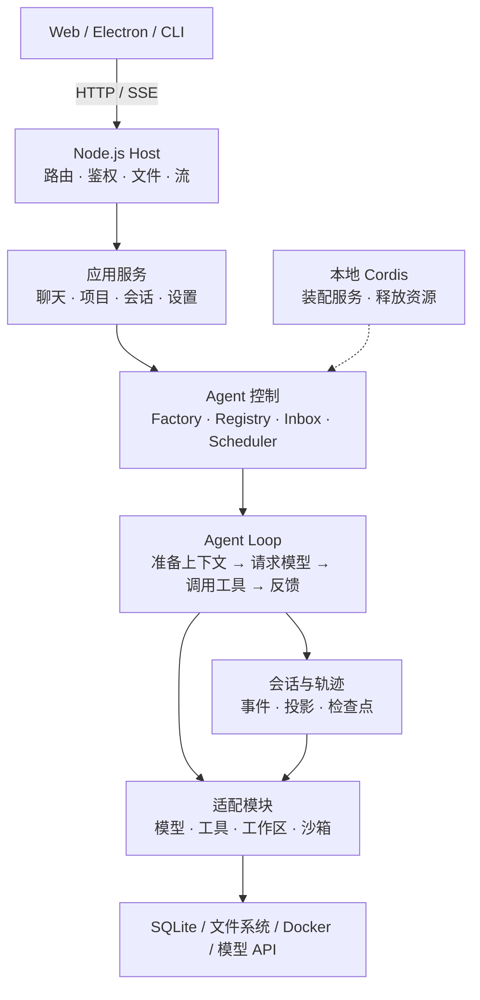

# 更新日志

记录实际代码修改、时间和验证结果；原理说明见学习笔记。

## 2026-11-05 00:14：编辑重发与重新生成保留旧历史（北京时间）

### 范围与状态

对应第 10 步第一阶段中的“编辑截断保留旧版本”。本次已实施并完成存储层验证；没有实现会话归档、版本切换界面、多任务摘要或历史搜索，deleteSession 的彻底删除语义不变。

### 原问题与修改方式

原 truncateFrom 会物理删除选中用户消息及其后续消息，并按时间删除产出记录。修改后为旧记录设置 superseded_by，普通读取只选择有效记录；每次保存截断前的消息/产出 ID 快照。消息正文不复制、不重写，旧的工具调用和结果仍保存在数据库。

### 实际代码修改

| 文件 | 具体修改 | 原因 |
|---|---|---|
| src/lib/server/db.ts | migrate 增加 messages/artifacts.superseded_by、有效记录索引和 session_revisions 表；记录截断锚点、时间及变更前 ID 快照；迁移在事务内执行 | 支持旧记录保留、旧视图追溯与可重复启动 |
| src/lib/server/db.ts | 旧库首次升级前 VACUUM INTO 一致性备份到 A_DATA_DIR/backups/a-before-history-*.db；初始化失败关闭连接 | 备份包含 WAL 已提交数据；迁移失败回滚，不继续使用半升级连接 |
| src/lib/server/store.ts | truncateFrom 按明确消息 ID 标记被替代记录；先核对当前有效 ID 快照，拒绝过期内存会话 | 不使用数组下标作为永久存储边界，避免过期操作截断另一轮新增记录 |
| src/lib/server/store.ts | 产出按 sourceToolCallId 或旧消息的 artifactId 关联，不再依靠相同毫秒的 createdAt 判断 | 防止误隐藏同时间但属于其他回答的产出；不明来源保守保留 |
| src/lib/server/store.ts | getSession、listArtifacts 和 listSessions.hasFiles 只考虑有效记录 | 刷新页面、产出列表及模型下一轮请求不混入已失效记录 |
| src/lib/server/store.ts | addMessage 在事务内按数据库 MAX(seq)+1 追加，提交后更新内存；addArtifact 也在写入成功后更新内存 | 序号不随当前视图缩短而复用，失败不污染内存 |
| src/lib/shared.ts | Artifact 增加可选 sourceToolCallId | 新产出可追溯来源调用，旧数据仍可读取 |
| src/lib/agent/run.ts | emitArtifact 写入实际 call.id | 即使工具产出后没有成功保存结果消息，也能通过调用定位产出 |
| src/app/api/chat/route.ts | 更新 truncateFrom 的接口注释 | 描述与保留历史的新行为一致；没有更改请求格式 |
| tests/history.test.mjs | 新增 10 个 node:test 行为测试，用临时 SQLite 运行实际存储代码 | 确定性验证迁移、版本保留、排序、产出与回滚，不需要模型服务 |
| AGENTS.md、docs/项目审查与优化清单.md | 调整文档记录分工，更新本阶段进度 | 更新日志记录代码细节；学习笔记解释原理 |

allSessions 仍保留全部记录用于既有统计用途，不能将它当作当前对话视图；当前界面与模型通过 getSession 获取有效记录。

### 实际验证结果

- node --test tests/history.test.mjs：10/10 通过。覆盖旧库迁移与迁移前备份、重复启动、用户隔离、旧工具链与 ID 快照保留、同毫秒产出关联、旧 artifactId 兼容、不明产出保留、重复编辑递增序号、失效摘要退出、非法锚点、过期快照、事务中途故障、追加失败内存一致性、全新数据库、彻底删除级联及迁移失败回滚。
- npm run typecheck：通过。
- npm run build：通过，Next.js 编译、类型检查和页面生成完成。Node 输出 SQLite 实验性功能提示，不影响本次检查结果。
- 未执行：真实模型对话、浏览器端编辑/重新生成交互、生产数据库迁移和历史版本查看界面测试。
- 测试仅使用系统临时目录中的数据库；没有打开或迁移实际用户数据库，没有调用付费模型。

### 数据影响、部署与回退边界

- 重新启动服务后，首次打开数据库时自动执行迁移。开发热更新可能继续复用旧连接，需要重启服务。
- 已存在消息和产出默认有效；此前被旧代码物理删除的内容不能恢复。
- 运行前源码文件备份保存在系统临时目录 aai-history-before-ju_eb7kx；不是生产数据库备份。
- 旧库升级前自动生成独立数据库快照；不要把它当成升级后新增消息的持续备份。
- 旧程序不认识有效/旧版本标记，不能直接用旧程序打开已产生新旧版本的新库。需要回退时先完整备份当前数据库和升级后新增记录，在副本中验证；不能直接覆盖恢复升级前快照而丢弃新数据。
- 工作区真实文件没有版本化或回滚；本次保留的是消息和 Artifact 内容记录。

### 已知限制与下一步

- 本次只保存旧记录与引用快照，没有用户可见的历史版本查看/恢复入口。
- 来源不明的旧产出保守保留，可能仍显示；没有按时间猜测归属。
- 同会话运行互斥和停止后重发的端到端生命周期没有在本阶段重构；过期快照检查不能替代运行锁。
- 第 10 步第一阶段整体仍在进行：会话归档与其他验收项尚待实施。下一步按用户指定范围推进，不提前修改摘要和检索模块。


## 2026-11-05 00:28：补齐历史存储改造注释，固定后续注释风格（北京时间）

### 目标与范围

按项目原有的中文讲解风格补齐上一轮历史存储改造的注释，解释原因、例子和边界。本次只修改注释、协作规则和文档，不调整函数逻辑、类型字段、SQL 或测试断言。

### 修改位置

- src/lib/server/store.ts：补充模块权限边界；getSession 的有效视图含义；addMessage 递增序号与提交后更新内存的原因；truncateFrom 的前后示例、来源关联、旧数据兼容、ID 快照及事务边界；说明 allSessions 统计包含旧记录，不能用于当前对话；说明产出列表只展示有效记录及彻底删除的区别。
- src/lib/server/db.ts：说明 WAL 下不能只复制主数据库文件的原因、备份时机和失败处理；补充迁移写事务、superseded_by 空值/变更 ID 含义、有效记录索引及修订表字段职责。
- src/lib/shared.ts：扩充 sourceToolCallId 的来源关联、同毫秒产出和旧数据兼容说明。
- src/lib/agent/run.ts：在 emitArtifact 解释为什么由执行器绑定来源调用，以及产出后工具失败的边界。
- src/app/api/chat/route.ts：说明数据库保留旧记录，不代表旧记录会自动发给模型。
- tests/history.test.mjs：说明临时数据库隔离、复用现有编译器的原因和故障注入的验证目标。
- AGENTS.md：新增“代码注释风格”，要求后续按职责、原因、必要例子、数据含义及失败边界写中文注释，避免重复翻译语法；行为变化时同步维护旧说明。

### 验证与影响

使用现有 TypeScript 编译器，分别对六个源码/测试文件修改前后的内容去除注释并编译，逐文件比较输出：6/6 一致，确认本次没有改变可执行代码、SQL 字符串或测试断言。

本次未运行类型检查、构建或行为测试：仅补注释，采用去注释编译输出对比；不把上一轮通过结果冒充本次重跑。未启动应用、调用模型或访问用户数据库。下一步仍由用户指定，不额外实施其他改造。


## 2026-11-05 01:05：运行中消息队列与插队（北京时间）

### 本次目标及实现状态

已实现运行中输入先进入待处理队列；队列显示在输入框上方，未提交草稿可编辑、删除。第三条点击上移只前移一位，第一条点击才请求插入当前任务。当前任务结束后可显式发送队首消息，其他草稿不自动发出。

队列保存在 SQLite，停止、刷新和服务重启不清空。主 Agent 在下一个请求边界加入选中的内容，与已有任务和工具结果一并组装上下文；不会并行启动另一个模型来抢改当前任务。

### 修改文件与具体内容

| 文件 | 修改内容 |
|---|---|
| src/components/MessageQueue.tsx | 新增队列卡片：编辑、删除、逐位上移、首条插队/空闲发送；显示服务端等待与送达状态，切会话丢弃过时响应。 |
| src/components/MessageQueue.css | 新增队列布局、滚动、编辑区、状态和错误提示样式。 |
| src/components/Workspace.tsx | 运行中发送改为持久入队，失败保留输入与附件；复用稳定请求 ID 重试；移除旧的按文字匹配和自动合并补发；接入队列及刷新后的远端运行状态。 |
| src/components/ChatPane.tsx | 在输入框上方渲染队列，更新运行中输入提示与发送按钮含义。 |
| src/lib/client.ts | 新增统一队列读取/操作 API；聊天发送支持 queuedMessageId。 |
| src/app/api/chat/note/route.ts | GET 查询当前用户队列与运行状态；POST 处理入队、编辑、删除、上移、插队，校验状态、参数和用户归属。 |
| src/lib/server/message-queue.ts | 新增 SQLite 队列服务、事务排序、数量/长度限制、稳定 ID 去重、正式消息关联与按实际请求消息 ID 确认送达。 |
| src/lib/server/notes.ts | 运行登记与持久草稿分离；增加同步占用及租约释放，旧请求不能误释放新任务。 |
| src/lib/server/db.ts | 迁移新增 message_queue 表、状态约束、会话外键及查询索引。 |
| src/lib/agent/run.ts | 在下一轮请求前插入明确选择的补充；首次模型响应才确认送达；结束前检查新插队内容并留出执行步骤；正式消息用稳定 ID 避免重复。 |
| src/app/api/chat/route.ts | 普通任务与队列任务共用运行占用；从服务端队列读取正文；接入保存/送达回调及关闭入口，失败和收尾释放对应租约。 |
| src/lib/shared.ts | 新增 QueuedMessage 类型，区分待处理、等待接收、已入历史等待模型、已送达。 |
| src/lib/llm/types.ts | 增加仅供内部投递确认的 sourceMessageId，不传给 OpenAI 兼容协议接口。 |
| src/lib/agent/context.ts | 请求视图保留原消息 ID，使同文消息和被摘要省略的内容可准确区分投递回执。 |
| src/lib/server/store.ts | 编辑历史时，把尚未送达且退出当前版本的补充退回草稿，分配新目标消息 ID，保留旧正文且不复用主键。 |
| tests/message-queue.test.mjs | 新增 13 个确定性测试，覆盖队列规则、权限、停止/重开、Agent 请求边界、失败/同文回执、运行占用与实际路由函数/SSE流程。 |

AGENTS.md 追加“修改结果展示”：以后每次改代码都提供修改清单与差异，并用可用工具打开右侧变更说明；学习笔记继续只讲原理。

### 状态与边界

- queued：待处理，可编辑、删除和调整顺序。
- ready：已选择插队，等待执行器读取，锁定草稿。
- received：正式消息已经保存，尚未确认模型请求响应。
- sent：包含对应原消息 ID 的请求已收到模型响应，不表示任务已经完成。
- 同样文字的两条消息使用不同 ID；请求失败不冒充送达，也不擅自删除尚未发送的内容。
- 每个会话最多 50 条未送达内容，单条最多 12000 字符，执行器每批最多读取 6 条已选中的补充。
- 刷新后可以查看持久队列及远端运行状态；本次没有实现重接旧 SSE 流或服务重启后恢复正在执行的任务。
- 已送达回执最近展示三条；正文和正式消息仍分别留在数据库中。插队影响后续决策，不撤销已执行的写入。
- 运行锁是当前服务进程内的占用，不是多实例分布式锁。

### 验证结果

- node --test tests/history.test.mjs tests/message-queue.test.mjs：23/23 通过（历史保留 10 项、队列/Agent/路由 13 项）。
- npm run typecheck：通过。
- npm run build：通过，Next.js 编译、类型检查及页面生成完成。
- 接口验证使用实际路由函数、原生 Request/Response/SSE 与临时数据库；登录身份、环境探测、无关后台服务及模型为受控夹具。测试确认当前请求不被改写、下一请求含原任务和补充、空闲发送从服务端取正文、跨用户请求被拒绝。
- 尝试启动隔离本地服务时，沙箱返回端口绑定 EPERM；因此未完成真实 HTTP 监听或浏览器实机点击/布局验证。没有把函数级接口测试称为浏览器验收。
- 未调用真实或付费模型，未访问用户实际数据库。测试夹具路径修正后已重新运行通过；最终结果以上述 23 项为准。

### 数据与部署

需要重启服务，使现有数据库连接重新打开并执行新增队列表迁移。迁移仅新增表和索引，既有历史记录与文件不删除。源码改动前备份位于系统临时目录 aai-message-queue-before-2t3r_lri。

本次的代码修改说明和完整差异见 [本次修改：消息队列与插队](./本次修改-消息队列与插队.md)，用于在右侧面板查看。后续由用户按实际体验指定调整，不自动扩展到历史检索或其他功能。

## 2026-11-05 01:26：过程中的每一步保留类型图标（北京时间）

### 目标与行为

此前 Trace 行只在执行中显示 DotSpinner，完成后行首没有图标。本次将操作类型与执行状态分开：读取、修改、命令、搜索等始终显示对应图标；运行时额外显示加载动画，结束后只移除动画。失败和跳过也保留原操作类型。

### 修改文件与内容

- src/components/Icons.tsx：沿用现有 16px 线性图标风格新增 IBook 阅读图标；更新思考图标说明。
- src/components/TraceIcon.tsx：新增统一类型映射，覆盖文件、目录、命令、Python、搜索、网页、数据、图表、技能、规划和反馈；未知工具使用扳手图标。
- src/components/Trace.tsx：通用 Row 始终显示类型图标，加载动画移至内容之后；工具、命令、参数草稿均传入实际类型；思考、规划、中间说明及自动反馈增加图标。收起后的摘要保留图标，完成后不再显示加载动画，用户仍可展开查看每一步。
- src/app/globals.css：为图标设置固定宽度、防挤压和主题颜色；适配多行规划/说明布局，以及失败状态颜色。

### 验证与范围

- npm run typecheck：通过。
- npm run build：通过。
- 使用现有 TypeScript 与 React 服务端渲染，在内存中导出实际 Row 做渲染核对：运行、完成、失败、跳过均有图标，仅运行时包含加载动画；读取、编辑和命令的图标不同；未知工具有兜底。没有为简单图标改动新增常驻测试文件。
- 未进行浏览器实机点击、尺寸和主题视觉检查；静态渲染不能代替这些检查。
- 仅涉及过程展示与文档，不修改工具执行、消息队列或数据库。按用户要求不再新建修改说明 MD，具体修改由源码补丁展示。

## 2026-11-05：补充学习笔记中审查、历史、队列和展示的讲解

### 目标与改动

根据用户要求，修改学习笔记中从 11 月 4 日项目审查到 11 月 5 日类型图标的六条记录，使其解释问题、例子、代码配合和实现边界。

- `docs/瀛︿範绗旇.md`：补充审查与验收区别、计划基线用途、编辑重发实例、消息 ID/存储序号/页面位置区别、产出来源、事务覆盖范围、注释实例、队列四状态和请求边界，以及类型图标与运行状态分离的说明。保留第 10 步计划及原有日期记录。
- 明确边界：编辑保留不等于会话永不删除；替代事务不包含后续模型生成；收到模型响应不等于完成补充要求；进程占用不等于分布式锁；早前测试通过不代表后续回归仍通过。
- 本文件只记录本次文档修改；没有复制代码变更清单到学习笔记，也没有新建同名文档。

### 核对与验证

- 对照当前存储、队列、运行占用、Agent 请求边界、上下文及类型图标源码核对说明；检查文档差异和新增内容格式。
- 未运行类型检查、构建、行为测试、Docker 或真实模型：本次只修改文档，没有新增业务能力、迁移数据或修改依赖。
- 正常命名的更新日志在本次操作期间已被删除，保留该删除状态；本次记录追加到已有乱码文件名的更新日志，没有重建重复文件。

## 2026-11-16 会话投影按需推导当前轮次与步骤

### 问题与方案

会话投影原来同时返回 `turns`、`currentTurn` 和 `currentStep`。虽然服务端最初共享对象引用，JSON 响应仍会把同一个轮次或步骤展开多次。客户端只更新其中一个对象时，另一处的数据可能过期。

现在轮次和步骤统一保存在 `turns`。读取时调用 `getCurrentPosition()`，通过数组末尾和 `endEventId` 得到未闭合的位置。最后一步结束后返回空步骤，最后一轮结束后返回空轮次和空步骤。轨迹仍核对实时 `activeRunId`，旧运行没有收尾记录时不会被显示为正在执行。

### 修改文件

- `src/lib/agent/agent-registry/core/types.ts`、`projection.ts` 移除两个重复字段，新增统一的读取函数。
- `src/lib/conversation-trace/core/projection.ts` 改为读取派生位置，并保留运行 ID、输入 ID 和相关步骤的匹配。
- `src/lib/agent/agent-registry/tests/message-queue.test.mjs` 验证实际接口的 JSON 形状、末尾边界更新、活跃工具和旧轮中断。

### 验证与数据影响

- 差异检查、TypeScript 类型检查和 Next.js 生产构建通过。`npm test -- --test-reporter=spec` 共 55 项通过。
- `GET /api/sessions/[id]/agent` 的 `projection` 不再返回 `currentTurn` 和 `currentStep`。读取者从 `turns` 推导即可，无需 SQLite 迁移。浏览器、真实模型及部署验证未执行。

## 2026-11-17 · 会话恢复、Vite 与 Node.js Host 重构

### 起因与设计取舍

- 原项目的 Next.js 入口同时承接页面、路由、认证、静态资源与 SSE。Agent 提交和执行也紧贴聊天请求。要理解一条消息从点击发送到工具落盘的全过程，需要把浏览器构建、网络接入、产品操作和 Agent 执行的入口分别暴露出来。
- 用户要求继续沿用 A.ai 的界面，自己实现 Node.js 服务和 Agent Harness，并参考 DSH 的 Host、模块和插件装配方式。React 继续渲染 UI，Vite 构建浏览器资源，自研 `node:http` Host 提供路由与流式通信，Cordis 负责服务安装和资源释放。
- 首期以模块化单体部署。Web 与 Electron 加载同一份 UI 产物，Web、Electron、CLI 共用 HTTP API。各职责在一个 Host 进程内通过模块接口协作，给将来的独立部署保留边界。Agent Loop、Context Engine、工具、会话数据和 Workspace 都有独立目录，可以沿着实际调用逐个学习。
- 拆分的核心是明确所有权。页面拥有当前视图和 SSE 订阅，Agent 拥有会话的执行权和收件箱，Scheduler 持有每次运行和取消信号，SQLite 持久化历史和工具检查点。刷新页面只重建订阅，关闭 Host 才会结束这一进程里的执行。

### 八层设计与本次落点

| 层次 | 职责 | 当前实现 |
| --- | --- | --- |
| 01 客户端 | 对话、工作区和设置交互 | `apps/web/` 进入 React，`apps/desktop/` 负责 Electron 窗口和本地 Host，`apps/cli/` 负责命令行请求。界面组件和视觉资源在 `packages/ui/` |
| 02 接入层 | HTTP 路由、请求参数、鉴权、文件与流式传输 | `apps/server/src/http.ts` 将 Node 字节流接成标准 `Request` 与 `Response`；`router.ts` 匹配路径和方法，`routes.ts` 显式挂载接口，`pages.ts` 加载 Vite 页面。各资源路由校验调用者权限 |
| 03 应用层 | 把聊天、项目、设置、用户等产品操作接到服务上 | `packages/application/` 接收产品逻辑。聊天入口 `chat/src/index.ts` 校验会话、取得执行权、构造输入并驱动 Agent Loop；部分产品操作仍直接从 Host 路由调用其服务 |
| 04 Agent 控制层 | 实例注册、创建和恢复、Inbox、运行许可及子任务入口 | `packages/agent/` 定义接口和工厂，`agent-registry/` 管理活跃实例，`scheduler/` 管理运行及订阅。现有研究子任务实现迁入 `subagent/` |
| 05 Agent 执行与状态 | 推进模型和工具调用，维护会话、事件、投影与核验 | 执行由 `agent-loop/` 编排，配合 `context-engine/`、`system-prompt/`、`llm/`、`tools/`、`tool-runtime/`、`permissions/` 和 `verifier/`。会话状态由 `session/`、`session-projection/`、`conversation-trace/`、`memory/` 和 `workspace/` 分工 |
| 06 Cordis 装配 | 安装服务、管理插件作用域和资源释放 | `packages/runtime/src/bootstrap.ts` 创建根 Context，提供模型解析、工具清单、Agent Registry 和 Scheduler。关闭 Host 时通过插件的 Effect 释放资源 |
| 07 基础设施适配 | 访问持久化存储、模型服务、文件与沙箱 | `storage/` 提供 SQLite 访问，`llm/src/providers/` 接模型，`workspace/` 与 `sandbox/` 负责文件和执行环境，`telemetry/` 承接已有审计代码 |
| 08 Node.js 运行环境 | 提供服务器、流、进程、异步 I/O 和取消信号 | 服务端统一在 Node.js 上运行。Electron 通过 `utilityProcess.fork()` 启动本地服务，窗口连接回环地址 |

SQLite 文件、工作区文件、Docker 沙箱和模型 API 是各适配模块访问的资源。图中的框表示代码责任边界，Node.js 为服务端各层提供运行环境。



### 目录与模块接口

```text
a-ai/
├── apps/                web、server、desktop、cli
├── packages/
│   ├── agent/、agent-registry/、scheduler/、subagent/
│   ├── agent-loop/、context-engine/、system-prompt/、llm/
│   ├── tools/、tool-runtime/、permissions/、sandbox/、verifier/
│   ├── session/、session-projection/、conversation-trace/
│   ├── memory/、workspace/、storage/、skills/、telemetry/
│   └── application/、protocol/、runtime/、ui/
├── vendor/              cordis、cosmokit
└── scripts/             构建、依赖检查、第三方源码同步及桌面打包
```

- 自有功能目录采用 `src/` 放实现、单数 `test/` 放测试及夹具，测试入口递归发现 `packages/**/test/` 与 `apps/**/test/` 中的用例。比如会话恢复的实现现在位于 `packages/session/session-recovery/src/`，独立恢复用例位于对应的 `test/`。第三方源码保留各自的许可证和上游测试目录。
- `packages/protocol/` 承接客户端和服务端共用的类型，包括会话消息、模型设置、队列快照和 Agent 事件。它把 `sessionId`、`runId`、`inputId` 等字段交给双方用同一套语义解释。构建入口通过 `check-dependencies.ts` 检查浏览器代码的导入边界。
- `packages/context-engine/src/context.ts` 根据当前有效历史组装请求，整理调用与结果的配对，估算请求占用并组织压缩。系统提示词归入 `packages/system-prompt/src/prompt.ts`，模型适配在 `packages/llm/`。会话的模型和思考强度从 `packages/session/src/model-selection.ts` 读取和校验，在缺少有效会话选择时回到默认配置。
- `packages/tools/` 实现具体工具，`packages/tool-runtime/` 提供工具清单、查找与暴露规则，`packages/permissions/` 保留审批判断，`packages/sandbox/` 承接受控命令和脚本执行。这个边界让 Agent Loop 根据权限和参数调用工具，工作区路径解析、文件读写和沙箱细节各自维护。

### 一条消息在新架构里如何执行

1. 浏览器或 CLI 提交 `POST /api/chat`。Host 路由认证用户并核对资源归属，聊天服务使用 Registry 创建或恢复会话。查看历史的接口可以直接读取会话和事件，与提交执行分开。
2. `packages/agent-registry/src/index.ts` 按会话登记实例，`packages/agent/src/factory.ts` 构造收件箱和运行状态。现有会话仍在线时复用实例，服务重启后可按同一会话 ID 从持久化记录重建实例。空闲 Agent 与会话数据都可以继续留存，归档有单独的准入规则。
3. `packages/scheduler/src/index.ts` 为本次执行创建独立取消信号，并通过 Agent 的 `openRun()` 获取执行权。一个会话同一时刻只交给一个持有者执行，不同会话能同时运行。一条流还可以依次处理这次运行中的多轮普通排队输入。引导消息可以在下一步请求前进入上下文。
4. `packages/agent-loop/src/run.ts` 在对应轮次及步骤中请求模型、流式输出文本或工具参数、等待权限确认、执行工具，并把结果作为下一步的上下文。对应的请求、结果和工具轨迹供后续检查。循环在完成、取消、中断或达到已有执行边界时收尾。
5. `packages/protocol/src/dispatch.ts` 用 `sessionId` 和 `runId` 绑定事件流，并校验会话或队列事件正文的归属。订阅断开时 Host 只结束响应，Scheduler 保留任务。收尾时 Agent 释放这次执行权，Scheduler 关闭订阅并保留有限的已结束运行记录。

### 运行状态、断线重接与轨迹

- 要同时看四件事。Session 是持久化会话，Agent 是当前进程中的实例，`runId` 代表一次运行，SSE 是客户端读事件的连接。Registry 的 `offline` 表示进程内尚未登记该实例。浏览器连接状态取决于自己的 SSE，是否正在执行还要检查 `activeRunId`。
- 例如 A 正在跑工具，B 同时提交另一条消息。切换到 B 或刷新 A 时，A 的执行仍由其原运行持有。浏览器通过 `GET /api/runs?sessionId=...` 找到活跃运行，用 `GET /api/runs/{runId}?after=...` 补读序号更大的事件。点停止时调用 `DELETE /api/runs/{runId}`。过期停止请求的作用域仍是原 `runId`。
- SSE 序号随每次运行递增。Scheduler 的每运行事件缓存上限为 20,000 帧，超出后分批裁掉旧帧，并保留至多 64 个已结束运行。游标超出可回放范围时接口返回 409，客户端可重新读取已保存的会话。当前缓存随进程结束而消失。
- `packages/session/src/log.ts` 读写 Agent 事件，`packages/session-projection/src/projection.ts` 从事件和会话推导轮次及步骤。投影保留 `turns`，`getCurrentPosition()` 检查末尾轮次、步骤和结束事件。旧运行如果只留下开始边界，还要用实时 `activeRunId` 判断它是否中断。
- `consumed-work.ts` 核对每条输入实际进展。排队、被领取、进入模型请求、被取消和从当前历史截断分别有对应证据。插队输入只有进入某一步的实际模型请求才记为已消费。轨迹包用请求及响应快照、工具定义、工具结果和子调用父节点帮助调试。

### 进程中断后的文件核验与补记

服务 A 已把配置文件中的 `timeout: 30` 改成 `timeout: 60`，但在工具结果写入 SQLite 前退出。重新打开对话后，内存中的运行和未保存输出已经丢失。下一次续聊先看 SQLite 中已经保存的助手工具调用、结果和检查点。

1. `edit_file` 与 `write_file` 在实际写入前提交检查点，记录会话、运行、输入、助手消息、步骤、调用 ID、目标相对路径及原始和预期字节的 SHA-256。新文件的原始指纹为空。检查点写入失败时，工具在触碰文件前报错。
2. 续聊取得该会话的执行权后，`file-recovery.ts` 读取当前历史上最近的中断轮次，按原调用对账。有正常工具结果时优先使用已有结果。如消息已保存而事件缺失，按原消息补记。缺少结果且有检查点时，只读目标文件并比较指纹。

| 核验看到的事实 | 保存的记录 | 接着怎样处理 |
| --- | --- | --- |
| 文件与预期字节一致 | 目标状态已满足 | 告知下一轮模型已经看到目标状态，从后续步骤接着处理 |
| 文件与写入前的字节一致 | 核验时仍是原状态 | 结合当前任务与文件现状判断是否再写 |
| 文件与两边均不同，或原目标无法读取 | 文件已变化或读不到，结果未知 | 保留核验证据，续聊轮的两个内置写入工具会保护此目标，先核对文件状态与用户意图 |

恢复时保留原轮的中断记录。新一轮使用已保存的部分回复、原工具调用和核验证据组织上下文，文件正文由实际工具操作维护。现已覆盖工作区内有检查点的两个内置写入工具。缺少检查点的旧调用以及终端、脚本、外部服务的副作用仍需各自的核验依据。

### Cordis 与第三方源码维护

- `vendor/cordis/` 固定 Cordis 4.1.0，`vendor/cosmokit/` 固定 Cosmokit 1.9.0，来源是 DSH 的 `39163dd30f`。`pnpm-workspace.yaml` 纳入 `vendor/*`，根工作区按确定的私有名称 `@A-ai/cordis` 解析本地源码，保留上游许可证和版权说明。
- `bootstrap.ts` 通过根 Context 注册模型服务、工具注册表、Agent Registry 和 Scheduler。Host 关停时由 Cordis Effect 停止接收新运行、触发取消并释放实例。Agent 创建、运行权限、各会话的事件归属和文件核验仍在对应的 Harness 模块内执行。
- `scripts/sync-vendor.ts` 接收本地 DSH 仓库及指定提交，先列出变动，加入 `--apply` 后才写入本地源码。来源和本地命名变更记录在 `vendor/README.md` 与 `THIRD_PARTY_NOTICES.md`。本次同步预览和固定提交对照为 0 个文件待同步，Loader 留待实际插件加载需求。

### 实施顺序、产物与旧文件清理

1. 保留旧版可运行基线和测试用会话副本。把 React 页面、字体、图标和样式迁到 Vite，保留 DOM、主题变量、CSS 顺序和原字体回退度量。将原路由迁到 `node:http`，保留登录接口、Cookie、深链接、SSE、静态资源和桌面更新文件的 Range 行为。
2. 抽出产品服务、Harness 与适配模块；接入本地 Cordis；将长任务的执行权移交 Scheduler。随后迁移 Electron 和 CLI，使用同一套 Host 及消息协议。
3. `scripts/build.mjs` 生成 `dist/server/web/`、`dist/server/server.mjs` 和 `dist/cli/main.mjs`。`scripts/electron-prepare.mjs` 生成桌面启动器。桌面打包把可独立复制的生产依赖、Host 和 Web 文件放到 `resources/server`。
4. 对照旧版和新版的 UI 后切换入口。比较时固定浏览器版本、视口、缩放和测试数据，分别验收深浅主题、窄屏、弹窗、选中、悬停及动画采样点。切换后清理 Next.js 配置、生成的类型入口和原 npm 锁文件。旧 `.next/`、仅含空目录与 Mac 元数据的旧 `src/`、空的旧 `electron/` 已移入回收站，桌面启动也移除了旧 `NEXT_TELEMETRY_DISABLED` 参数。当前 `node_modules/` 安装的是 pnpm 工作区依赖，已被 Git 忽略。

### 验收结果

| 检查 | 已验证结果 |
| --- | --- |
| 依赖与类型 | `pnpm install --frozen-lockfile --ignore-scripts`、`pnpm check:dependencies` 和 `pnpm typecheck` 通过，包含 Cordis 声明生成和浏览器导入检查 |
| 生产构建与行为 | `pnpm test` 完成生产构建并通过 66 项测试。覆盖鉴权、静态资源、会话深链接、更新下载、双会话并行、SSE 补读与独立停止。清理旧目录后复跑通过 |
| 浏览器运行验证 | Edge 实测刷新后拿到同一个 `runId`，显式停止该任务返回 204，SQLite 中该输入只有一条。CLI 在本机 Host 上验证了登录后列出会话 |
| Web 视觉验收 | 固定 Edge 157.0.4341.60、测试数据、设备像素比和动画采样时间，1400×900 与窄屏 760×820 的 10 个场景像素差异为 0。覆盖对话、深浅主题、模型菜单、轨迹、弹窗、侧栏选中及悬停，并核对抽样字号、行高、颜色、布局和滚动高度 |
| 桌面与资源 | `pnpm electron:prepare` 通过，项目外的独立服务产物可启动。Windows 用同一缓存版本 Electron 44.9.3 对比 8 个验收场景，像素差异为 0。按用户要求跳过登录和注册页的视觉对照。31 个迁移的 CSS、字体和图标文件 SHA-256 一致 |
| 中断恢复 | 当日早期用两个独立进程复现文件写入后退出。下一进程继续原会话时，读取到检查点并将核验结论传入新模型请求，文件修改时间保持一致。测试使用临时库和受控模型 |

### 启动、数据影响与后续边界

- 本地执行 `pnpm install --frozen-lockfile` 后可用 `pnpm dev` 启动。生产构建的入口是 `pnpm build` 和 `pnpm start`。桌面开发使用 `pnpm electron:dev`，CLI 命令可通过 `pnpm cli help` 查看。
- 当天较早的文件恢复开发增加了 `agent_file_writes` 表及启动迁移，服务打开旧库时会创建此表。后续架构迁移沿用这套 schema。验证使用隔离库或旧数据副本，Compose 继续使用 `a-ai-data` 数据卷和 `/app/.data`，Electron 继续使用原用户数据路径。
- 已交付单 Host 进程内的运行所有权和断线重订阅。跨进程阶段续跑、持久事件游标和各类外部工具的副作用核验仍是后续设计项。现有研究型子任务、权限批准和沙箱模块已随本次迁移归位。通用子 Agent 调度、MCP 接入、统一的插件加载和更细的资源预算仍待实现。
- Windows 正式安装器受 Electron 44.7.2 下载影响尚未验收。macOS 打包、Docker 实际构建、真实模型及生产部署未执行。后续的运行恢复进度见 [Harness 改进路线图](./Harness改进路线图.md) 的 M2-03。

文件拆分经过、原理与独立验证记录见 [学习笔记](./学习笔记.md) 同日条目。


## 2026-11-27 · M2-02 上下文工程 · 单轮长任务分段压缩、软硬预算校准、前缀缓存稳定、摘要容错重试与大结果精准回读

### 范围与状态

对应 `scan_entire_project` 分支的上下文工程优化与 [Harness改进路线图.md](./Harness改进路线图.md) 的 M2-02 主体加固。本次已落地主 Agent 侧 5 项核心改造并通过全量 186 项自动化测试；子 Agent 独立上下文摘要（替代 `context-boundary.ts` 256 字硬截断）、结构化任务工作态（M2-01）与跨会话检索尚未实施。

### 原问题与触发条件

1. **单轮多步与超长首轮输入无法压缩**：`planCompact()` 仅按真实 `user` 消息切分且硬要求 `users.length > KEEP_TURNS`（2）。单轮跑 15～30 步（`users.length === 1`）、单条超长用户输入后继续执行、或两轮对话中首轮很长时，均恒返回 `null`，无法生成摘要。
2. **预算口径失真、缺少输出预留与硬预算护栏**：
   - `compactThreshold()` 原为 `min(0.7 * contextWindow, 96_000)`，大窗口拖到 96k 才触发整理；
   - `run.ts` 在 `compactIfNeeded()` 时尚未拼入 `turnEnv`（工作区文件列表）、历史召回卡片与 `budgetHint`，导致最终发出的请求比估算多出数千 token；
   - 未结合上一轮 API 返回的真实 `usage.inputTokens` 校准本地 `estimateTokens()` 的低估偏差，也未预留输出空间或收紧 `maxOutputTokens`，在小窗口或第 0 步超长输入下容易触发超窗 400 或输出截断。
3. **第 1 层 `slim()` 滑动截断持续击穿 Prompt Cache**：当前轮使用 `toolIdx.slice(-6)` 动态决定只保留最后 6 个工具全文，从第 7 步起每新增一步都会回头改写更早的工具消息，导致服务端前缀缓存步步失效。
4. **摘要校验过脆、大结果字段错配且无纠错重试**：`summary.ts` 原先仅用 `source.content.includes(quote)` 逐字符匹配，遇到 `\r\n` 或缩进空白差异即报错；且 `transcript()` 为已卸载大结果提供的是 `toolResult.fields` 而非正文，模型照抄也会触发校验失败；一旦失败即记入 `failedCompactKeepFrom` 跳过，没有带错因纠错重试机会。
5. **大结果指针缺关键字段、委派结果未卸载且只能字符偏移盲翻**：`slim()` 渲染 `toolResult` 指针时丢掉了已提取的 `fields`；`run.ts` 排除了 `isDelegation` 导致大型 `delegate_tasks` / `research` JSON 直接灌进主上下文；`read_tool_result` 只能靠 `offset/limit` 逐页翻找。

### 设计方案与关键取舍

1. **三层压缩切分 + 单轮用户锚点重建**：
   - 切分优先级：① 多轮优先保留最近 `KEEP_TURNS`（2）轮；② 少轮长前文（或单轮压缩后进入新轮）保留最新 1 轮完整对话；③ 单轮内按完整协议块边界（`user` / `assistant`，绝不落在 `tool` 上）切分，优先保留最近 `KEEP_RECENT_STEPS = 2` 块、净省不足时退到保留最近 1 块。
   - 单轮内压缩时，`buildContext()` 自动在保留步骤前补回本轮用户锚点 `anchorUser()`（`<= 1,500` 字原样保留，超长保留 70% 头 + 30% 尾以保住末尾 `<附件>` 路径），确保 Anthropic 等接口首条非系统消息始终为 `user`，且 `turnStart` 与 `<环境>` 挂载不失效；`retainedFrom` 统一返回真实轮次用户消息 ID，保证 `history_segments` 历史召回上界有效。
   - 净节省 token 按 `estimateRequest(slim(part)) + oldAnchor - newAnchor` 精确核算；`transcript()` 将单条用户消息窗口扩至 `4,000` 字并保留头尾。
2. **两道水位 + `usage` 保守校准 + 输出预留 + 硬预算护栏**：
   - `outputReserve(contextWindow)` 为输出与思考链预留最小空间（小窗口按比例保底 512～40%，大窗口封顶 16k）；`hardInputBudget = contextWindow - outputReserve`；软压缩水位 `compactThreshold = min(floor(hard * 0.75), 64_000)`（支持 `A_COMPACT_TOKENS` 覆盖且不超过 `hard`）。
   - `calibrationFactor()` 仅在 API 返回真实 `usage`（`!usage.estimated`）时按 `[1.0, 2.0]` 保守纠偏本地估算（上升即时生效防爆窗，回落平滑衰减）。
   - `prepareContext()` 对全量装配后的请求（消息 + `turnEnv` + 历史卡片 + `budgetHint` + 工具 Schema）统一核算；超过 `hardLimit` 时按“切 `tight` 撤卡片 → 撤 `turnEnv` → `fitHardBudget()` 逐级收缩工具正文/旧参数/极端首条输入”降级；当剩余窗口紧于提供方默认输出上限时，自动收紧请求的 `maxOutputTokens`。
3. **前缀缓存保护与结构化指针**：
   - 正常模式下移除 `slim()` 对当前轮的 `slice(-6)` 滑动回改（同轮内前缀只追加不修改），仅紧急 `tight: true` 模式才裁剪当前轮更早的非卸载结果。
   - `formatToolResultPointer()` 在固定短长度内直接带出 `toolResult.fields`（最多 320 字）与总字符数。
4. **摘要防幻觉底线 + 格式容错 + 有限重试**：
   - `quoteMatchesSource()` 保留精确匹配，同时允许换行/连续空白折单空格比对，并允许命中 `source.toolResult.fields`；`sourceId` 与 `progress.status` 仍严格校验，修改数字或编造内容仍被拦截。
   - `summarize()` 在校验/格式失败时带具体错因最多纠错重试 1 次（总尝试上限 2 次），累计两次用量避免漏记或重复计账。
5. **委派大结果落库与关键词精准回读**：
   - `describeToolResult()` 扩展常用工具及 `delegate_tasks` / `research` 围栏 JSON 字段提取，并在无领域字段时附带 120 字单行 `preview`；`run.ts` 放开 `!isDelegation` 限制（仅 >1,200 token 的大委派结果卸载，小结果保持内联）。
   - `readToolResult()` 与 `read_tool_result` 新增可选 `query` 参数，支持按关键词不区分大小写按行过滤并返回行号与字符偏移。

### 实际代码修改清单

| 文件 | 具体修改 | 原因 |
| --- | --- | --- |
| `packages/context-engine/src/context.ts` | 新增 `isRealUser`、`isCompactBoundary`、`findTurnUserIndex`、`anchorUser`，改造 `lastCompact()`、`buildContext()`、`planCompact()`、`transcript()` | 支持单轮多步、超长首轮输入与两轮长前文分段压缩，并保持 Anthropic 首条 `user` 协议与 `retainedFrom` 历史索引兼容 |
| `packages/context-engine/src/context.ts` | 新增 `outputReserve`、`hardInputBudget`、`calibrationFactor`、`calibratedRequestTokens`、`fitHardBudget`，将大窗口默认软水位封顶调整为 64k | 统一软硬两道预算、真实 `usage` 校准与发送前硬护栏，防止超窗 400 或输出截断 |
| `packages/context-engine/src/context.ts` | 移除正常模式下 `slim()` 的 `toolIdx.slice(-6)` 滑动裁剪，新增 `formatToolResultPointer()` | 避免第 7 步起逐轮改写旧消息击穿 Prompt Cache，并在指针中暴露关键字段 |
| `packages/context-engine/src/context.ts` | 升级 `summarize()` 支持带具体错因最多重试 1 次，新增 `mergeUsage()` 与 `counted` 防重计账 | 防止单次偶发格式误差锁死压缩，并保证多轮尝试的用量统计准确 |
| `packages/context-engine/src/summary.ts` | 新增 `normalizeWhitespace()`、`quoteMatchesSource()` | 在不放松文字/数字与工具状态核对的前提下，容忍空白/换行微差并对齐大结果 `toolResult.fields` 回检 |
| `packages/storage/src/tool-results.ts` | 扩展 `fieldsByTool`、新增 `extractDelegationFields()` 与无字段 `preview`；`readToolResult()` 新增可选 `query` 关键词过滤分支 | 覆盖更多高频工具与大型委派结果落库摘要，避免大结果盲翻字符偏移 |
| `packages/tools/src/read-tool-result.ts` | 为 `read_tool_result` 增加可选 `query` 参数及长度校验并透传至 `readToolResult()` | 允许模型按关键词/报错/分支名一步回读大结果 |
| `packages/agent-loop/src/run.ts` | 接入全量预算核算（含 `turnEnv`、召回卡片、`budgetHint` 与 `inputScale`）、发送前硬预算护栏、`maxOutputTokens` 动态收紧、真实 `usage` 校准与大型委派结果落库 | 解决预算口径漏算、输出无预留及大委派 JSON 灌爆主上下文问题 |
| `packages/context-engine/test/context.test.mjs` | 更新指针断言并新增 6 项测试（单轮多步连续二次压缩与 Anthropic 协议、单条超长输入与两轮长前文及无效边界回退、第 7 步起前缀稳定、空白容错/字段回检与重试、委派卸载与 `query` 回读、软硬水位/`usage` 校准与硬预算护栏） | 端到端回归覆盖本次全部上下文改动与边界条件 |
| `AGENTS.md` | 更新“优化记录”“代码注释风格”“修改结果展示”规则，明确每次更改代码后必须在 `docs/更新日志.md` 编写非常详细的更新日志 | 按用户要求恢复并强化 `docs/更新日志.md` 作为每次代码改动的详尽变更台账 |
| `docs/学习笔记.md`、`docs/Harness改进路线图.md` | 追加原理讲解并同步 M2-02 进度 | 保持设计文档、路线图与真实源码一致 |

### 行为变化

- 3 轮以上且早期轮次足够长的多轮会话保持原有切分行为（保留最近 2 轮）；1 轮多步长任务、1 轮超长用户输入与 2 轮长前文会话现均可触发结构化摘要。
- 1M 等大窗口模型的默认软压缩封顶从 `96k` 调整为 `64k`（`A_COMPACT_TOKENS` 仍可覆盖）；小窗口自动扣除输出预留并在必要时收紧请求 `maxOutputTokens`。
- 同轮非 `tight` 模式下历史工具消息前缀保持稳定，不再从第 7 步起回头裁剪旧消息；大结果指针直接展示关键字段，`read_tool_result` 支持按 `query` 关键词精准定位。
- 摘要因格式、引语或状态校验失败时自动带错因重试 1 次，两次都失败才跳过该切分点。

### 验证命令与结果

- **静态检查**：`node --experimental-strip-types scripts/check-dependencies.ts` 通过；`git -c core.safecrlf=false diff --check` 通过。
- **类型检查**：`node node_modules/typescript/bin/tsc -p vendor/tsconfig.json && node node_modules/typescript/bin/tsc --noEmit` 通过。
- **生产构建**：`node scripts/build.mjs` 通过（生成 Web 与 Server 产物，保留 Vite 既有大分块提示）。
- **行为测试**：
  - 非回环全量：`node --experimental-strip-types --test --test-concurrency=2 "tests/*.test.mjs" "packages/**/test/*.test.mjs" "apps/desktop/test/*.test.mjs" "apps/cli/test/*.test.mjs" "vendor/cordis/tests/*.test.mjs"` 通过 **174/174**（含 `context.test.mjs` 全部 12 项）。
  - 服务端回环全量：`node --experimental-strip-types --test --test-reporter=spec apps/server/test/host.test.mjs` 通过 **12/12**。
  - 合计全量 **186/186 通过**（0 失败、0 跳过）。
- **未执行项**：真实供应商模型调用、浏览器视觉验收、桌面打包与生产部署。

### 数据/兼容影响、已知限制与下一步

- **数据与兼容**：无需 SQLite 迁移；旧 `compact.keepFrom`、旧消息记录及不带 `query` 的 `read_tool_result` 调用完全兼容；原始消息一条不删。
- **已知限制**：`packages/subagent/src/context-boundary.ts` 的 256 字硬截断尚未升级为子 Agent 独立摘要；结构化任务工作态（M2-01）和跨会话检索待后续推进；真实模型下的缓存命中率与 token 收益尚未跑固定评测集量化对比。
- **下一步**：推送 `scan_entire_project` 分支至 GitHub 后，按优先级推进子 Agent 独立上下文摘要、结构化任务工作态（M2-01）与固定多步回归评测。


## 2026-11-27 · M2-01 / M2-02 上下文工程第二阶段 · 结构化任务工作态、前缀缓存加固、单字中文与同项目跨会话历史检索及轨迹可观测性

### 范围与状态

对应 `scan_entire_project` 分支的上下文工程第二阶段与 [Harness改进路线图.md](./Harness改进路线图.md) 的 M2-01（本次任务工作状态）及 M2-02 剩余加固项。本次已完成主 Agent 任务工作态推导与过期失效判定、2 处前缀缓存边界修复、单字中文检索与同项目共享跨会话历史回查，以及轨迹与前端上下文指标透出，全量 192 项自动化测试通过。

> **关于子 Agent 上下文边界的协同说明**：经核对远端并行的 `origin/feat/subagent-recovery` 分支，该分支已在 `packages/subagent/src/context-boundary.ts` 实现了按引文/关键词加权的 `boundedContext()` 与 `read_evidence` 回读工具。为避免重复开发和跨分支合并冲突，本分支刻意不修改 `packages/subagent/`，保持与 `feat/subagent-recovery` 零文件重叠。

### 原问题与触发条件

1. **`slim()` 遇到 `/任务要求` 指令误判当前轮起点**：`packages/context-engine/src/context.ts` 中 `slim()` 仍按 `role === "user" && !feedback` 找 `turnStart`，未排除 `taskRequirements !== undefined` 的 `/任务要求`、`/清除任务要求` 指令消息；用户在长工具步骤后补充任务要求时，刚执行完的本轮工具输出与推理会被当成“旧轮次”提前裁剪。
2. **同轮内历史自动召回卡片数量抖动破坏 Prompt Cache**：`packages/agent-loop/src/run.ts` 每步重新按软水位决定挂 3/2/1/0 张召回卡片，若某一步刚好逼近软水位导致卡片张数缩减，会改写 `messages[turnStart]` 文本，击穿当轮后续步骤的前缀缓存。
3. **缺少结构化的本次任务工作态（M2-01）**：跨轮多步任务或约束更新后，模型只能从分散的历史消息中重新梳理目标、待办计划、已读/已改文件、已失败方法和待解决项；当用户通过 `/任务要求` 或运行中补充（`note`）改变约束时，更早生成的计划与代码验证没有显式的过期提示。
4. **历史检索缺失单字中文匹配、长度归一化与同项目跨会话回查**：
   - `history_segment_terms` 对多字中文仅存 2-gram，用户查单字中文（如 `税`）命中为空；
   - 原排序仅按 `SUM(weight)`，长段落天然词多容易盖过短小精准段落；
   - `search_history` / `read_history_execution` / `read_tool_result` 仅限当前会话，项目开启“对话互相可见（`share: true`）”时只能看到固定 400 字首尾摘要，无法按需深入回查同项目历史会话的执行清单与工具结果。
5. **第一阶段引入的软硬预算与校准指标未在轨迹和界面透出**：调试长对话时无法从轨迹「选项」直观看到 `hardLimit`、`outputReserve`、`inputScale`、`budgetMode`、`recalledCards`、`hasWorkingState` 及 `compactCount`。

### 原因与设计取舍

1. **确定性、轮内稳定、不回流压缩正文的任务工作态（`working-state.ts`）**：
   - 采用纯函数确定性推导而非再调一次模型：零额外 token 成本、零幻觉、无需新增 SQLite 表；简单纯文本问答（无工具/计划/补充/产出）返回 `null`，绝不污染轻对话。
   - **兼顾工作态与 Prompt Cache 稳定**：`buildContext()` 仅归纳 `[compactStart, stateCutoff)`（即上次有效压缩边界之后、本轮真实用户输入之前）的执行态事实，且产出物也仅筛选 `cutoff` 之前产生的项，因此**同一轮所有常规工具步骤的系统提示词字节 100% 不变**，既不会把已被摘要压掉的旧原文泄漏回系统提示词，也不会击穿当轮缓存；同时扫描 `cutoff` 之后的约束变更（`/任务要求` 或 `note`），即时把旧计划与旧验证标为过时。
   - 拼接顺序固定为 `system → summary → workingState → requirements`，确保用户显式 `/任务要求` 始终保持最高优先级。
2. **召回卡片张数在轮内锁定**：`recalled` 按 `retainedFrom` 缓存首次选定的 `lockedCount`，同轮后续步骤只要未超 `hardLimit` 就保持同一份卡片集合，避免因软水位临界变化反复改写 `messages[turnStart]`。
3. **零迁移兼容的单字中文检索 + 严格授权的同项目跨会话回查**：
   - 保留 `history_segment_terms` 现有表结构与 2-gram 索引，查询包含单字 Han/Kana 时通过 `instr(t.term, sc.value) > 0` 回退匹配（已有历史库无需重建索引即可生效），并引入 `(matchedWeight * (1 + 0.25 * distinctTerms)) / (1 + 0.04 * tool_calls)` 归一化排序。
   - 新增 `resolveReadableSession()` 集中校验跨会话读取权限：仅当源会话与目标会话同属当前用户、同一未归档项目、两会话均未归档且项目明确开启 `share === true` 时才放行；跨用户、跨项目、未共享或已归档项目一律返回空/`null`。
4. **复用的轨迹与前端展示**：沿用 `conversation-trace` 现有 `RequestSnapshot.agent` 扩展可选字段（旧快照无感兼容），UI 复用 `TraceMeta` 与 `ComposerBar` 的 `Kv` 行样式，不新增样式类或布局破坏。

### 逐文件具体改动清单

| 文件 | 核心函数 / 字段变动 | 原因 |
| --- | --- | --- |
| `packages/context-engine/src/working-state.ts`（新增） | 新增 `WorkingState` 系列类型、`deriveWorkingState()`、`formatWorkingState()`、`workingStatePrompt()` | 确定性推导目标、最新补充、计划（含过期标记）、文件读写/验证状态（含过期标记）、已失败尝试、产出与待办；实现简单问答零注入与轮内前缀稳定 |
| `packages/context-engine/src/context.ts` | `buildContext()` 新增 `artifacts` 可选参数并接入 `workingStatePrompt()`，返回 `hasWorkingState` 与 `compactCount`；`slim()` 将 `turnStart` 判定改为 `isRealUser()` | 在跨轮保留段注入结构化工作态且不回流已压缩正文；修复 `/任务要求` 指令导致 `slim()` 误判当前轮起点的问题 |
| `packages/agent-loop/src/run.ts` | `recalled` 增加 `lockedCount` 锁定同轮召回卡片；`prepareContext()` 返回 `budgetMode`、`recalledCards` 等指标并透传 `session.artifacts`；`conversationTrace.request()` 写入完整 `agent` 上下文治理字段 | 防止召回卡片张数抖动击穿当轮 Prompt Cache；让轨迹完整记录软硬水位、校准系数、预算模式与工作态状态 |
| `packages/storage/src/history.ts` | 新增 `HistoryScope`、`resolveReadableSession()`；升级 `searchHistory()` 支持单字中文回退匹配、长度归一化打分与 `scope="project"`；`readHistoryExecution()` 支持 `targetSessionId` 授权回查 | 解决单字中文查不中与长段落偏置；打通共享项目内跨会话历史检索与执行清单回查并严守隔离边界 |
| `packages/storage/src/tool-results.ts` | `readToolResult()` 新增可选 `targetSessionId` 并经 `resolveReadableSession()` 鉴权 | 允许同项目开启共享的会话按 `resultId + sessionId` 只读回读兄弟会话工具正文 |
| `packages/tools/src/history.ts` | `search_history` 新增可选 `scope: "session" \| "project"`；`read_history_execution` 新增可选 `sessionId` 参数 | 向模型暴露同项目跨会话历史检索与执行清单回查能力 |
| `packages/tools/src/read-tool-result.ts` | `read_tool_result` 新增可选 `sessionId` 参数并透传 `readToolResult()` | 闭环跨会话大结果按页或按 `query` 精准回读 |
| `packages/conversation-trace/src/types.ts` | `RequestSnapshot["agent"]` 新增可选 `hardLimit`、`outputReserve`、`inputScale`、`calibratedInputTokens`、`budgetMode`、`recalledCards`、`hasWorkingState`、`compactCount` | 持久化每步上下文治理决策快照，兼容历史记录 |
| `packages/ui/src/components/TraceRequestContent.tsx` | `TraceRequestOptions` 新增 `budgetModeNames` 与上述 7 项上下文治理元信息行 | 在轨迹详情「选项」直观查看预算模式、校准系数、召回卡片、工作态与压缩次数 |
| `packages/ui/src/components/ComposerBar.tsx` | `ContextRing` 计算 `compactCount`，大于 0 时渲染 `上下文压缩` 行 | 让用户在对话页直接看到本会话已发生的摘要压缩次数 |
| `packages/context-engine/test/working-state.test.mjs`（新增） | 新增 4 项行为测试 | 覆盖简单问答零注入、工作态推导与约束变更失效标记、`slim()` 跳过 `/任务要求`、同轮召回锁定缓存稳定及轨迹治理指标记录 |
| `packages/context-engine/test/history.test.mjs` | 新增 2 项行为测试 | 覆盖单字中文检索与长度归一化排序、同项目 `share: true` 跨会话检索/执行/结果回读及跨项目/未共享/跨用户拒绝 |
| `docs/更新日志.md`、`docs/学习笔记.md`、`docs/Harness改进路线图.md` | 补齐详尽变更台账、原理解析并同步 M2-01 / M2-02 进度 | 满足协作规范并保持文档与代码现状一致 |

### 行为变化

- 简单纯文本对话无任何变化（不注入工作态）。
- 跨轮含工具执行/待办/文件读写/失败尝试的任务，系统提示词会在摘要与显式 `/任务要求` 之间自动附带紧凑的 `## 当前任务工作态`；一旦用户更新约束或发出补充，旧计划与旧文件验证会自动标为过时。
- 对话中途发送 `/任务要求` 不再导致前一步工具结果与推理被 `slim()` 提前裁剪；同轮内历史自动召回卡片张数锁定，不再因接近软水位而反复改写本轮输入。
- `search_history` 支持单字中文查询与相关性归一化排序，并在项目开启 `share` 时支持 `scope="project"` 跨会话检索，配合 `read_history_execution` 和 `read_tool_result` 的可选 `sessionId` 可回查同项目历史原文。
- 轨迹详情「选项」与底部上下文环弹层分别新增上下文治理指标与累计压缩次数展示。

### 验证命令及结果

- **静态检查**：`git -c core.safecrlf=false diff --check` 与 `pnpm check:dependencies` 均通过（客户端依赖边界合规）。
- **类型检查**：`pnpm typecheck`（`tsc -p vendor/tsconfig.json && tsc --noEmit`）通过。
- **生产构建**：`pnpm build`（由 `pnpm test` 触发）通过（Vite 与 esbuild 均成功，保留既有的 Vite 分块大小提示）。
- **行为测试**：`pnpm test` 全量 **192/192 通过**（0 失败、0 跳过），包含新增的 `working-state.test.mjs` 4 项与 `history.test.mjs` 2 项。
- **未执行项**：真实外部模型调用、浏览器视觉验收、桌面端安装包构建与生产部署。

### 数据/兼容/部署与回退影响

- **数据与兼容**：无 SQLite 表结构变更、无数据库迁移；所有新增工具参数（`scope`、`sessionId`）和轨迹快照字段均可选且向后兼容旧记录。
- **回退边界**：纯应用/上下文层与 UI 展示改动，回退当前提交即可完整恢复，不留脏数据。
- **已知限制与下一步**：
  - 任务工作态当前只跟踪结构化工具调用、待办、文件与失败记录，不调用模型做开放式语义“关键发现”提取（避免额外延迟与幻觉）；
  - 单字中文检索通过 `instr(t.term, ?)` 在已限定会话/项目范围内扫描，适用于普通会话规模，若单项目积累数万段落时可再评估专门的 FTS5 索引；
  - 下一步：与 `feat/subagent-recovery` 合并后统一验证主/子 Agent 全链路上下文协作，并结合真实模型跑固定多步回归评测（对比 Prompt Cache 命中率与总输入 token）。


## 2026-11-27 · M2-02 上下文工程 · 高风险边界专项回归测试与两处硬预算/关键词分页缺陷修复

### 范围与状态

对应 `scan_entire_project` 分支上下文工程（`packages/context-engine/` 及紧密配合的 `packages/storage/src/tool-results.ts`）专项测试补齐与边界缺陷修复。在 `packages/context-engine/test/` 新增专项测试文件 `context-edge-cases.test.mjs`（8 项端到端与单元回归），并在编写测试分析源码时定位并修复了两处真实边界缺陷；全量测试由 192 项提升至 **200/200 通过**。不涉及 `packages/subagent/`（保留给并行分支 `feat/subagent-recovery`）。

### 原问题与触发条件

1. **高风险边界缺少独立回归覆盖**：既有测试覆盖了主链路，但对以下关键问题点尚未建立独立断言——同轮中途新建产出物不改写 `system` 缓存前缀、本轮 `note` 即时使前轮计划/验证失效、失败工具重试成功后自动消除、已压缩旧正文不经 `workingStatePrompt` 回流、`pairCalls`/`withFileRecoveries` 孤立/缺失结果兜底与 `recovery:*` 排除出 `planCompact.sources`、`summarize()` 剥离 `<think>` 与 `>16,000` 字拒绝、连续 2 次摘要失败记住 `failedCompactKeepFrom` 降级 `tight`、`tokensAfter >= before` 拒绝落库、`clip()` 保护 `【A.ai 自动检查】`、`calibrationFactor` 夹紧/衰减与 `A_COMPACT_TOKENS` 封顶、`hard-guard` 下撤掉召回卡片、以及归档兄弟会话/项目后阻断跨会话共享。
2. **真实缺陷 1：`fitHardBudget()` 第 3 级对纯英文/ASCII/代码超长输入裁剪不足**：`context.ts` 原第 3 级兜底用 `excessTokens * 1.25` 计算待裁字符数（假设 1 字 ≈ 1 token），且仅遍历一次。遇到纯英文日志、代码或 JSON（`estimateTokens()` 按约 4 字符 = 1 token 估算）时，一次仅裁掉约 31% 超额 token，裁剪结束后仍远超 `hardLimit`。
3. **真实缺陷 2：`readToolResult(..., query)` 多页关键词检索在剩余预算不足时会拦腰截断命中行或丢弃行尾**：`tool-results.ts` 原逻辑只要 `budget > 0` 就会把下一条命中行按剩余预算硬截（`snippet.slice(0, budget)`），既可能切掉位于行尾的匹配关键词，又不会把该行计入 `nextOffset`，导致翻页时跳过该行剩余正文；若后续出现更短命中行还可能越序塞入当前页。

### 原因与设计取舍

1. **按消息实际字/token 密度动态收敛裁剪**：`fitHardBudget()` 第 3 级改为根据当前用户消息的 `charsPerToken = content.length / (estimateTokens(content) * factor)` 计算待裁字符数，并配合最多 4 轮且严格缩短的收敛循环，确保纯中文、纯英文/代码及中英混排超长输入都能压回 `hardLimit` 内，同时继续保留头尾锚点与 `assistant/tool` 配对。
2. **关键词分页“整行推进 + 保底 1 条”**：`readToolResult(..., query)` 改为仅当 `nextOffset === null && (hits.length === 0 || snippet.length <= budget)` 时写入当前页——单条超长行作为本页首条仍保证推进不死循环；若本页已有命中且剩余预算装不下整行，则立刻将 `nextOffset` 指向该行起始偏移，由下一页完整返回，杜绝截断丢失与乱序。
3. **测试分层归位**：严格遵循“每个功能目录下 `src/` + `test/`”的结构规范，把 8 项问题导向边界用例独立归入 `packages/context-engine/test/context-edge-cases.test.mjs`，避免与既有 `context.test.mjs` / `history.test.mjs` / `working-state.test.mjs` 重复，并由根脚本 `"packages/**/test/*.test.mjs"` 自动发现执行。

### 逐文件具体改动清单

| 文件 | 核心函数 / 字段变动 | 原因 |
| --- | --- | --- |
| `packages/context-engine/src/context.ts` | 修复 `fitHardBudget()` 第 3 级极端兜底逻辑：按 `charsPerToken` 与校准系数 `factor` 计算 `trimChars`，增加至多 4 轮严格收敛循环 | 修复纯英文/ASCII/代码/JSON 超长用户输入裁剪一轮后仍超出 `hardLimit` 的边界缺陷 |
| `packages/storage/src/tool-results.ts` | 修复 `readToolResult()` 关键词 `query` 分页条件为 `nextOffset === null && (hits.length === 0 || snippet.length <= budget)` | 防止本页剩余预算不足时将下一条命中行拦腰截断丢失关键词，同时保证多页翻页顺序一致且不死循环 |
| `packages/context-engine/test/context-edge-cases.test.mjs`（新增） | 新增 8 项上下文工程专项边界回归测试 | 覆盖工作态与缓存隔离、协议配对与文件恢复、摘要重试封顶与降级、无效压缩拦截与自动检查保护、`fitHardBudget` ASCII 退化、校准系数与环境变量上限、`hard-guard` 撤回卡片、关键词分页与归档隔离 |
| `docs/更新日志.md`、`docs/学习笔记.md` | 追加本次详细变更台账与边界原理讲解 | 满足 `AGENTS.md` 协作规范 |

### 行为变化

- 纯英文、日志或代码类超长首轮输入触发硬预算护栏时，能可靠收敛到 `hardLimit` 以下，避免发往模型接口时仍因超窗返回 400。
- `read_tool_result` 带 `query` 多页翻阅长结果时，不再出现页末命中行被半截切断或行尾内容在翻页后丢失的问题。
- 新增 8 项常驻回归测试，每次 `pnpm test` 自动守卫上下文工程的各项关键边界。

### 验证命令及结果

- **专项测试**：`node --experimental-strip-types --test --test-reporter=spec packages/context-engine/test/context-edge-cases.test.mjs` 通过 **8/8**（0 失败、0 跳过）。
- **静态检查**：`git -c core.safecrlf=false diff --check` 与 `pnpm check:dependencies` 均通过。
- **类型检查**：`pnpm typecheck`（`tsc -p vendor/tsconfig.json && tsc --noEmit`）通过。
- **生产构建**：`pnpm build`（由 `pnpm test` 触发）通过。
- **全量行为测试**：`pnpm test` 全量 **200/200 通过**（0 失败、0 跳过，较上一提交 192 项净增 8 项）。
- **未执行项**：真实外部模型调用、浏览器 UI 实机测试、桌面打包与生产部署。

### 数据/兼容/部署与回退影响

- **数据与兼容**：无数据库迁移、无协议或工具参数签名变更，完全向后兼容既有会话和工具调用。
- **部署与回退**：仅涉及内存上下文裁剪、只读结果分页与测试文件，回退本次修改即可无副作用恢复。
- **已知限制与下一步**：下一步仍待与 `feat/subagent-recovery` 合并后联合验证主/子 Agent 全链路，并在真实模型上开展固定多步评测以量化 Prompt Cache 命中率与总消耗。
